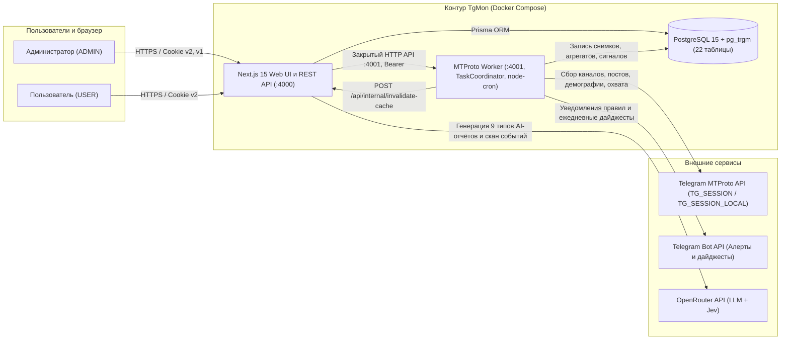

# TG Monitor (TgMon)

Веб-приложение для мониторинга и сравнения Telegram-каналов и групп. MTProto-сборщик сохраняет аудиторию и публикации в PostgreSQL; интерфейс показывает динамику, метрики вовлечённости, рекламную нагрузку, цитирование, эвристические сигналы риска и AI-отчёты.

Документация по текущим функциям и эксплуатации сверена с исходным кодом **27 октября 2026 года**. Версии зависимостей и команды задаются в [package.json](package.json), точные установочные версии: в [package-lock.json](package-lock.json).

**Стек:** Next.js 15 / React 19 / TypeScript, Prisma 6 / PostgreSQL 15, teleproto (преемник GramJS, npm alias `telegram`), node-cron 4, Tailwind CSS 3, Recharts, Vitest 4. Docker и CI используют Node.js 22. Web слушает порт **4000**.

## Архитектурный обзор



## Возможности

- **Многопользовательский режим**: новые пользователи подают заявку через Telegram и получают доступ после одобрения администратором. У каждого свой список каналов (`UserChannel`), флаги «Мой канал» и «Избранное», AI-отчёты и правила уведомлений при общем пуле сбора данных и ключе OpenRouter.
- Главная: «Мой канал», избранное, сравнительная таблица, KPI, лидеры роста и падения, лучшее время публикации и сворачиваемый радар трендов с быстрым запуском анализа упущенных тем конкурентов.
- История подписчиков и постов за 24 часа, 7 и 30 дней; ER, ERR, VR, CR для групп, EP, Content Score, нишевые бенчмарки (P25/медиана/P75), разбивка по форматам контента, топ реакций, детектор вирусных постов и детектор периодов «тишины» канала. При неполной истории дельты показывают фактическое покрытие.
- Статьи Telegram: извлечение текста rich-сообщений, чтение в карточке публикации, поиск и использование в новых AI-отчётах; восстановление ранее пустых статей отдельной утилитой.
- Страница канала: графики аудитории и активности, heatmap, поиск постов, Content LTV, граф цитирования, цепочки распространения и роль канала в инфополе, эффективность рекламных размещений, Wrapped-карточка и AI-анализ.
- Рекламная аналитика: `Ad Load` за 7 дней, снимки рекламного охвата через 1/12/24/48 часов, оценка стоимости поста и CPM в гривнах (с поддержкой персональных переопределений цены/CPM на канале), глобальный поиск `/posts` с режимом Ad Spy и рейтингом топ-рекламодателей.
- Четыре эвристики антифрода, журнал `fraud_signals`, `RiskBadge` и индекс цитирования. Балл риска не является вероятностью или доказательством накрутки.
- Гибкие Telegram-уведомления и дайджесты на `/settings`:
  - Пороговые правила по метрикам канала с интервалом (cooldown) 24 часа для каждой пары «правило и канал» (`AlertRuleFire`).
  - Мгновенные постовые уведомления по ключевым словам (`metric = "keyword"`) и виральным всплескам просмотров (`metric = "viralPostMultiplier"`) с однократной отправкой на каждый совпавший пост (`AlertRulePostFire`).
  - Глобальный и персональный ежедневный Telegram-дайджест по активным каналам пользователя.
- Языковая статистика и доля включённых уведомлений «Моего канала» при наличии доступа к Telegram BroadcastStats. География в текущей реализации недоступна и не выводится из языка.
- Девять AI-маршрутов: `summary`, `super-report`, `compare`, `trends`, `content-gap` («Упущенные темы конкурентов»), `audience`, `persona` («Психологический портрет» — доступен и виден только роли `ADMIN`), `action-plan`, `compare-reports`. Архив `/reports` позволяет открыть, сравнить, скачать HTML и безвозвратно удалить сохранённый отчёт.
- Сканер анонсов мероприятий из собранных постов, страница `/events`: двухэтапный отбор (`Jev` через OpenRouter + генеративная модель), транзакционное слияние дублей, сохранение изображений постов, быстрые фильтры дат («Сегодня / Завтра», «На этих выходных», «На этой неделе», «В этом месяце»), фильтр бесплатных событий и экспорт в `.ics` или Google Календарь.

Подробности и ограничения: [обзор продукта](docs/overview.md), [формулы](docs/analytics-formulas.md), [API](docs/api-reference.md).

## Среды запуска и правило изоляции Telegram-сессий

Проект работает в трёх средах, и критически важно не смешивать их MTProto-сессии:

1. **Локальная среда (Windows `C:\TgMon` / WSL `/mnt/c/TgMon`)**:
   - Полный стек в Docker с Hot Reload (`tgmon-postgres` + `tgmon-web` + `tgmon-worker`): запускается через `docker compose -f docker-compose.yml -f docker-compose.dev.yml up -d --build` (или `bash dev-web.sh`, если образы уже собраны).
   - Контейнер `tgmon-worker` в `docker-compose.dev.yml` работает с `WORKER_LOCAL_MODE=true` и использует **строго отдельную изолированную сессию `TG_SESSION_LOCAL`** (устройство `TgMon Local Dev`), никогда не обращаясь к серверной `TG_SESSION`.
2. **Боевой сервер OVH (`ovh-vps`, `/opt/tgmon`, домен `tgmons.online`)**:
   - Полный Docker-стек (`postgres` + `web` + `worker` через `docker-compose.yml` + `docker-compose.prod.yml`), Nginx + HTTPS, деплой скриптом `bash update.sh`.
   - Использует **серверную сессию `TG_SESSION`** (устройство `TgMon Server Worker`) и крутит регулярный сбор по cron.
3. **GitHub (`origin/main`)**:
   - Публичный репозиторий без секретов; пароль БД передаётся через `${POSTGRES_PASSWORD}`.

> **Почему нельзя использовать одну строку сессии и локально, и на сервере?**
> Если одна и та же строка `StringSession` (`auth_key`) одновременно подключается с двух разных IP, Telegram выбрасывает ошибку `AuthKeyDuplicated` и принудительно сбрасывает авторизацию. Благодаря разделению на `TG_SESSION` (только на сервере) и `TG_SESSION_LOCAL` (только локально) обе среды работают параллельно на одном или разных аккаунтах без потери авторизации.

## Быстрый старт локально (WSL / Windows)

### 1. Подготовка и изолированная локальная авторизация Telegram

```bash
npm ci
cp .env.example .env
```

Заполните в `.env` параметры `DATABASE_URL` (`postgresql://...@127.0.0.1:5432/tgmon?schema=public`), `TG_API_ID`, `TG_API_HASH` и `COLLECT_API_TOKEN`, затем один раз создайте локальную сессию `TG_SESSION_LOCAL`:

```bash
npm run auth:local:qr
```

- Команда `npm run auth:local:qr` поднимет локальную страницу **http://localhost:4099** с картинкой QR-кода.
- Откройте **http://localhost:4099** в браузере на ПК, а на телефоне зайдите в **Telegram → Настройки → Устройства → Подключить устройство** и наведите камеру на QR-код (не кликайте по `tg://login` ссылке напрямую — Telegram блокирует прямые клики).
- Либо используйте `npm run auth:local` для входа по номеру телефона и коду в терминале.
- Полученная сессия автоматически запишется в `.env` как `TG_SESSION_LOCAL`. Миграции запускайте после старта PostgreSQL: `npm run prisma:migrate` (или используйте `dev-web.sh`, который выполняет эту команду).

### 2. Запуск проекта локально

В терминале WSL (`/mnt/c/TgMon`):
```bash
bash dev-web.sh
```
*(или `npm run dev:local`, если PostgreSQL уже запущен).*

Скрипт при доступном локальном PostgreSQL попытается остановить его, запустит Docker Compose без пересборки образов и применит миграции через локальный Prisma CLI. Контейнеры `web` и `worker` запускаются независимо от наличия `TG_SESSION_LOCAL`. Для ручного запуска без Docker существует `npm run dev:local`: он запускает web и worker с `--local --no-cron`, но требует уже работающую БД.

`npm run seed` **удаляет существующие посты, снимки и каналы** перед созданием демонстрационных данных. Это команда только для отдельной тестовой БД.

## Docker и развёртывание на сервере

Подробная инструкция в [docs/deployment.md](docs/deployment.md) описывает все сценарии:
1. **Штатный локальный запуск в Docker** (`bash dev-web.sh` или Compose с dev override).
2. **Production на сервере OVH** (`docker-compose.yml` + `docker-compose.prod.yml`, обновление через `bash update.sh`, серверная сессия `TG_SESSION`).
3. **Ручной запуск на хосте** (`npm run dev:local` с уже работающей PostgreSQL и `TG_SESSION_LOCAL`).

### Production-обновление на сервере (`/opt/tgmon`)

```bash
bash update.sh
```
Скрипт выполняет `git pull --ff-only`, пересобирает образы `web` и `worker`, запускает `prisma migrate deploy` и перезапускает контейнеры.

### Многопользовательский вход и доступ к Web UI

На странице `/login` доступны вход через Telegram, вход по паролю для прежних аккаунтов и резервный мастер-ключ администратора. Первый вход через Telegram создаёт заявку без доступа к данным. Администратор одобряет, удаляет или блокирует её в `/settings`. Заблокированная учётная запись не может войти с уже выданной cookie. Существующие аккаунты могут привязать Telegram в настройках.

Для Telegram Login настройте в BotFather OIDC Client ID, Client Secret, Trusted Origin и точный Redirect URI. Переменные web: `TELEGRAM_LOGIN_CLIENT_ID`, `TELEGRAM_LOGIN_CLIENT_SECRET`, `TELEGRAM_LOGIN_REDIRECT_URI`. Секреты хранятся только в окружении сервера. Подробности: [запуск и эксплуатация](docs/deployment.md#telegram-login-заявки-и-доступ-к-web-ui).

Ключ OpenRouter (`SystemSetting.aiToken` или `OPENROUTER_API_KEY`) настраивается администратором один раз и используется всеми приглашёнными пользователями для генерации AI-отчётов.

## Конфигурация

| Переменная | Использование |
| --- | --- |
| `DATABASE_URL` | PostgreSQL для web, worker и Prisma CLI |
| `POSTGRES_PASSWORD` | Пароль БД для production Compose (`docker-compose.prod.yml`) |
| `TG_API_ID`, `TG_API_HASH` | Ключи приложения Telegram (`my.telegram.org`) |
| `TG_SESSION` | Серверная MTProto-сессия (живёт только на сервере в worker) |
| `TG_SESSION_LOCAL` | Локальная MTProto-сессия для `worker:local` (создаётся через `npm run auth:local` / `auth:local:qr`) |
| `WORKER_LOCAL_MODE`, `WORKER_DISABLE_CRON` | Первый выбирает `TG_SESSION_LOCAL`; второй при `true` отключает cron и сбор при старте. Dev Compose по умолчанию не отключает cron |
| `TG_PHONE` | Подсказка номера телефона для CLI авторизации |
| `COLLECT_API_TOKEN` | Мастер-ключ входа в Web UI, ключ подписи сессионных cookie и Bearer для worker |
| `COLLECT_CRON` | Основной сбор, по умолчанию `0 * * * *` |
| `COLLECT_ON_STARTUP` | Первичный цикл только при строке `true` |
| `DEMOGRAPHICS_CRON` | Демография, по умолчанию `0 3 * * 0` |
| `WEB_INTERNAL_URL` | Адрес web для сброса кэша из worker (`http://web:4000` в Docker, `http://localhost:4000` локально) |
| `WORKER_INTERNAL_URL` | Закрытый адрес worker для web: `http://worker:4001` в Compose, `http://localhost:4001` локально |
| `TELEGRAM_REQUEST_TIMEOUT_MS` | Таймаут MTProto, по умолчанию 30000 мс |
| `CHANNEL_MAX_CONSECUTIVE_ERRORS` | Отключение после N последовательных ошибок, по умолчанию 10 |
| `OPENROUTER_API_KEY` | Общий ключ OpenRouter для AI-отчётов и сканера событий |
| `TELEGRAM_BOT_TOKEN`, `TELEGRAM_CHAT_ID` | Отправка пользовательских правил и уведомлений об автоотключении канала |
| `TELEGRAM_LOGIN_CLIENT_ID`, `TELEGRAM_LOGIN_CLIENT_SECRET`, `TELEGRAM_LOGIN_REDIRECT_URI` | Вход через Telegram OIDC в web; адрес возврата должен быть зарегистрирован в BotFather |
| `HEALTH_STUCK_THRESHOLD_MINUTES` | Порог зависшего SyncJob, по умолчанию 120 минут |
| `HEALTH_STALE_THRESHOLD_MINUTES` | Порог давности завершённого SyncJob, по умолчанию 720 минут |

Не все параметры перечислены в `.env.example` или передаются Compose. `MY_CHANNEL_USERNAME` есть в примере, но код его не читает: «Мой канал» назначается через UI/API. Поля AI на `/settings` применяются к генерации: сохранённые ключ и модель имеют приоритет, `OPENROUTER_API_KEY` и `z-ai/glm-5.3-flash` служат резервом. Jev использует тот же ключ и собственную модель `~typesafe/jev-latest`. [Подробности конфигурации](docs/deployment.md).

## Разработка и проверки

```bash
npm test
npm run test:coverage
npx tsc --noEmit
npx eslint src
npm run build
```

`npm run lint` пока содержит `next lint`; CI запускает `npx eslint src` с `eslint.config.mjs`. При проверке используйте команду CI. Количество тестов не фиксируется в документации: актуальный результат даёт `npm test`.

GitHub Actions выполняет typecheck, ESLint, Vitest и затем build: push в `main`/`VPS_Ready`, PR в `main`, ручной запуск. Workflow не развёртывает приложение.

## Документация

- [Обзор продукта и ограничения](docs/overview.md)
- [Архитектура, схема хранения и потоки](docs/architecture.md)
- [Компактная карта проекта](docs/project-map.md)
- [Метрики и формулы](docs/analytics-formulas.md)
- [Полный справочник API](docs/api-reference.md)
- [Запуск, конфигурация и эксплуатация](docs/deployment.md)
- [Решение по архитектуре антифрода](docs/adr/0001-anti-fraud-detection-architecture.md)
- [Решение по Telegram-клиенту и статьям](docs/adr/0002-telegram-rich-messages.md)
- [Служебные скрипты](scripts/README.md)
- [Git-процесс](docs/git-workflow.md), [порядок работы с кодом](docs/codex-workflow.md)
- [Текущее состояние и передача работы](docs/current-state.md)

## Допущения

1. Отключение мониторинга сохраняет историю; `DELETE /api/channels/:id?permanent=true` физически удаляет канал и связанные записи по каскадам Prisma.
2. Назначение «Моего канала» снимает предыдущий флаг в транзакции. Флаг можно снять совсем; уникального ограничения `isMine` в БД нет.
3. Сбор приватных каналов требует предварительного участия аккаунта сборщика.
4. Отсутствующие данные Telegram не равны нулю; подпись ячейки — объяснение UI, а не подтверждение причины отсутствия данных.
5. Точность истории зависит от расписания и доступной глубины сбора. Материализованные и сырые агрегаты имеют разные временные окна.
