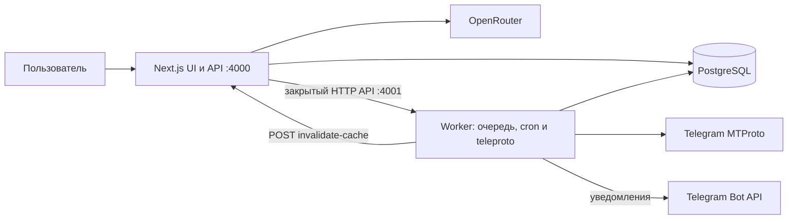
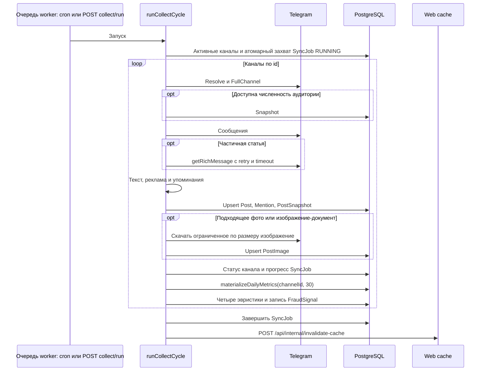

# Архитектура TgMon

Состояние реализации сверено 16 октября 2026 года. Источники: [Prisma-схема](../prisma/schema.prisma), [база данных](database.md), [worker](../src/worker/index.ts), [коллектор](../src/worker/collector.ts), [запросы метрик](../src/lib/metrics/queries.ts) и [Compose](../docker-compose.yml).

## Контекст и процессы

Web и worker работают отдельными Node.js-процессами. Web передаёт добавление канала и ручной сбор в закрытый HTTP API worker на порту 4001 с Bearer-токеном; порт не публикуется из Compose. Только worker использует MTProto-сессию. Ответ ручного API ожидает завершения цикла.

`src/worker/task-coordinator.ts` ставит основной сбор, демографию, рекламный охват и первичный backfill в одну последовательную очередь. Повторный запрос основного сбора получает 409. Создание SyncJob сериализовано транзакционным advisory lock PostgreSQL; активный RUNNING блокирует второй цикл между процессами. RUNNING старше порога `HEALTH_STUCK_THRESHOLD_MINUTES` (по умолчанию 120 минут) помечается FAILED перед новым запуском. При SIGINT/SIGTERM worker прекращает приём задач, ждёт активное задание до 30 секунд и останавливает основной сбор между каналами, завершает SyncJob как PARTIAL/FAILED при прерывании и отключает TelegramClient.

Очередь действует в одном процессе worker. Для одновременного запуска нескольких worker демография и рекламный охват потребуют отдельной межпроцессной координации; штатный Compose запускает один worker.

## Слои приложения

| Слой | Модули и ответственность |
| --- | --- |
| UI | `src/app/`, `src/components/`: страницы, интерактивные таблицы, графики, отчёты; главная и детализация загружают метрики через API |
| API | `src/app/api/`: чтение и управление каналами, статистика, AI, события, сохранённые изображения постов, удаление отчётов, настройки, health и экспорт |
| Метрики | `src/lib/metrics/queries.ts`, `aggregate.ts`, `calculate.ts`, `engagement.ts`, `adShare.ts`; публичные реэкспорты в `src/lib/metrics.ts` |
| Производные оценки | `ep.ts`, `scoring.ts`, `fraudDetector.ts`, `citationIndex.ts`, `pricing.ts` |
| Сбор | `client.ts` → `fetcher.ts` → `collector.ts` → `persister.ts`; текст в `message-content.ts`, упоминания в `post-mentions.ts`, изображения в `post-image.ts`, ошибки в `retry-policy.ts` |
| Дополнительные задания | `worker/demographics.ts`, `worker/ad-reach.ts` |
| Хранение и кэш | `prisma.ts`, `materialize.ts`, `cache.ts` |

## Модель данных

Полная спецификация моделей PostgreSQL 15, типов полей, вторичных индексов, перечислений и каскадов приведена в документе [База данных и схема Prisma](database.md).

Схема `prisma/schema.prisma` включает **16 моделей** и перечисление **`SyncStatus`** (`RUNNING`, `COMPLETED`, `PARTIAL`, `FAILED`; статус фонового цикла сбора в `SyncJob`):

| Prisma-модель | Таблица | Назначение |
| --- | --- | --- |
| `Channel` | `channels` | Идентификаторы Telegram, тип, ниша, флаги, статус и ошибки сбора |
| `Snapshot` | `snapshots` | История численности аудитории |
| `Post` | `posts` | Текущие счётчики и текст публикации; unique `(channelId, messageId)` |
| `PostImage` | `post_images` | Одно изображение поста до 1 МБ; байты и MIME-тип хранятся отдельно от строки Post |
| `PostSnapshot` | `post_snapshots` | Нерегулярная история просмотров свежих постов для LTV |
| `PostViewSnapshot` | `post_view_snapshots` | Рекламные контрольные точки; unique `(postId, hoursAfterPost)` |
| `Mention` | `mentions` | Ссылка из собранного поста на username/tgId; target не является внешним ключом на Channel |
| `SyncJob` | `sync_jobs` | Начало/конец цикла, статус (`SyncStatus`), счётчики и краткая ошибка |
| `ChannelMetricDaily` | `channel_metrics_daily` | Дневные агрегаты UTC; unique `(channelId, date)` |
| `AudienceDemographics` | `audience_demographics` | Языковые доли, дата снимка, nullable JSONB `countryBreakdown` |
| `AiReport` | `ai_reports` | Тип и строковый JSON-ответ LLM, необязательный канал; запись может быть физически удалена из архива |
| `Event` | `events` | Мероприятия и события, извлечённые из публикаций Telegram |
| `EventMention` | `event_mentions` | Связи M:N событий с исходными постами; unique `(eventId, postId)` |
| `SystemSetting` | `system_settings` | Запись `global` с настройками AI и полями digest |
| `AlertRule` | `alert_rules` | Схема пользовательских правил; исполнения в worker пока нет |
| `FraudSignal` | `fraud_signals` | Тип, значение, причина и время срабатывания эвристики |

Миграции находятся в `prisma/migrations/`. Последняя на дату сверки: `20261016000000_add_post_images`, создающая таблицу `post_images`. Предыдущая `20261013212052_add_event_dismissed_at` добавила nullable-поле ручного скрытия событий. Схема включает `pg_trgm` и GIN-индекс текста постов.

Отключение канала меняет `isActive`; физическое удаление использует каскады связей Prisma. `isMine` переносится транзакцией, но уникального ограничения в БД нет. `SystemSetting.aiToken` хранится в БД; API возвращает только признак наличия и маскированное превью. Параметры digest и `AlertRule` сами по себе не включают фоновые функции.

## Основной цикл сбора

1. Первый сбор получает до 1000 сообщений и оставляет последние 30 дней; последующие циклы перечитывают до 200 последних сообщений без `min_id`. `lastMessageId` хранит максимум, но не ограничивает текущий запрос.
2. FullChannel даёт число участников. При изменении названия оно обновляется; отдельного суточного задания метаданных нет. Ошибка FullChannel может оставить доступный fallback-счётчик, таймаут передаётся выше.
3. При изменении аудитории относительно предыдущего снимка на ≥1% по модулю **или** ≥500 участников отправляется опциональное Bot API-уведомление.
4. Альбомы сводятся к существующему посту с тем же `groupedId`. Upsert обновляет известные счётчики/текст, а `subscribersAtPublish` задаёт только при создании. Для backfill это число участников во время сбора.
5. Для постов моложе 7 суток с известными просмотрами создаётся `PostSnapshot`. Эти снимки не дедуплицируются по циклу. Упоминания при непустом новом списке удаляются и создаются заново; `createdAt` отражает время записи, не исходную дату публикации.
6. `postsAdded` увеличивается на обработанное сообщение, включая обновления и части альбомов. Это не число новых уникальных строк Post.
7. Материализация пересчитывает 30 календарных UTC-дней; её ошибка логируется отдельно. Затем общий `try/catch` обрабатывает блок антифрода: сбой в нём может пропустить оставшиеся проверки канала, но не отменяет сбор.
8. Для поста с подходящим медиа сборщик сохраняет одно фото или изображение-документ до 1 МБ в `PostImage`; у альбома сохраняется первое доступное изображение связанного поста. Ошибка загрузки изображения логируется без отмены сбора постов.

`fetcher.ts` делает паузу 1000–1299 мс перед попыткой и до трёх попыток при FLOOD_WAIT. Ожидание — указанное Telegram время + 2 секунды + jitter до 1499 мс; экспоненциального backoff в этом коде нет. Это задержка на вызов, а не распределённый глобальный rate limiter.

### Статьи Telegram

Пакет `telegram` установлен как npm alias для `teleproto@1.229.0` (слой API 229), преемника GramJS. Импорты и формат `StringSession` сохранены. [Причины и последствия выбора](adr/0002-telegram-rich-messages.md). Старый слой 198 возвращал новые статьи как `MessageMediaUnsupported` без текста.

`message-content.ts` преобразует `richMessage` в обычный текст с абзацами через `Rich.toPlainText`: заголовки, списки, таблицы, цитаты и подписи медиа. Изображения внутри статей не извлекаются, OCR и воспроизведение оформления Telegram не выполняются. Отдельные фото постов сохраняет `post-image.ts`. Для `part=true` полный текст догружается через `getRichMessage` с существующими ограничением частоты, повторными попытками и таймаутом. Ошибка догрузки изолирована: счётчики поста сохраняются, прежние текст, рекламная классификация и упоминания не перезаписываются неполным результатом.

Полный текст сохраняется в существующее `Post.text`; миграция БД не нужна. Он доступен интерфейсу, поиску, рекламной классификации и новым AI-отчётам в пределах их существующих выборок и лимитов длины. Старые отчёты автоматически не пересчитываются. Восстановление пустых записей за пределами последних 200 сообщений описано в [инструкции утилиты](../scripts/README.md#восстановление-текста-статей).

### Ошибки основного цикла

`retry-policy.ts` увеличивает `consecutiveErrors` и отключает канал при достижении `CHANNEL_MAX_CONSECUTIVE_ERRORS` (по умолчанию 10). Успех сбрасывает счётчик. При `TelegramTimeoutError` цикл пытается переподключить клиент; неудачный reconnect завершает цикл с fatal error. Некоторые ошибки чтения сообщений внутри `collectChannelData` только логируются, поэтому успешный статус не гарантирует полноту постов.

## Материализация, API и кэш

API предпочитает `ChannelMetricDaily`, если за период есть хотя бы одна строка; иначе использует сырые Snapshot/Post. Worker рассчитывает дневные агрегаты, web — сводные метрики, EP, Content Score, CI и динамический антифрод. Это не модель «worker только пишет сырые данные».

`metricsCache` живёт 5 минут, `bestTimeCache` — 30 минут. Кэш находится в памяти одного процесса. API добавления, PATCH/DELETE канала, ручного сбора и внутренней инвалидации очищают оба кэша. PUT избранного их не очищает. Перезапуск процесса очищает кэш; общего кэша между репликами нет.

В `finally` основного цикла worker отправляет запрос на `WEB_INTERNAL_URL` с `COLLECT_API_TOKEN`, если оба заданы. Сетевое исключение логируется; текущий caller не проверяет HTTP-статус ответа. Запись об успешной инвалидации в логе поэтому не гарантирует HTTP 200.

## Антифрод

Worker анализирует до 30 дневных строк и до 30 последних постов, сохраняет только сработавшие сигналы. При чтении overview/detail web загружает сигналы за 30 дней и вызывает чистую функцию `runFraudAudit`; сама она не читает БД. Сохранённый сигнал соответствующего типа имеет приоритет перед повторным вычислением этого типа.

При отсутствии сохранённых сигналов расчёт использует переданные данные. Overview передаёт посты за 7 дней и дневные метрики за 30 дней; detail — последние 20 постов (либо recentPosts при короткой выборке) и сырую историю аудитории выбранного периода. Даты упоминаний эти вызовы не передают, поэтому динамическая проверка скачков не эквивалентна фоновой. [Формулы и ограничения](analytics-formulas.md), [ADR](adr/0001-anti-fraud-detection-architecture.md).

## Демография и рекламный охват

- Демография: `DEMOGRAPHICS_CRON`, default `0 3 * * 0`; только активные `isMine` broadcast-каналы без успешного снимка с начала текущей недели (воскресенье 00:00 по часовому поясу процесса). Проверка `canViewStats`, вызовы GetBroadcastStats/LoadAsyncGraph в `statsDc`, разбор последней общей точки. Ошибки изолированы от основного сбора. `countryBreakdown` остаётся SQL NULL.
- Рекламный охват: фиксированный cron `15 * * * *`, посты с `isAd: true` не старше 50 часов. Фильтра `channel.isActive` здесь нет. Проверяются отсутствующие точки 1/12/24/48 часов с допуском 5 минут до срока. Все просроченные точки получают текущие просмотры; фактическое время хранится в `capturedAt`.
- Дополнительные задания не запускаются автоматически при старте: `COLLECT_ON_STARTUP` относится только к основному циклу.

Cron и часть heatmap используют часовой пояс Node.js-процесса; материализация использует UTC. Явного timezone в `cron.schedule` нет.

## AI, события и граница доступа

AI-обработчики формируют промпты из сохранённых данных, вызывают `callOpenRouter` и пытаются сохранить ответ через `saveAiReport`. Восемь типов отчётов описаны в [API](api-reference.md). Для анализа рыночных трендов (`/api/ai/trends`) посты отбираются исключительно из активных каналов (`isActive: true`), входящих в Watchlist (`isFavorite: true`) или являющихся «Моим каналом» (`isMine: true`) за последние 48 часов с непустым текстом (до 100 публикаций). Event Scanner сначала проверяет непустые тексты через Jev, затем генеративная модель извлекает детали из отобранных постов и связывает события с Post. Фильтр по ключевым словам применяется только при недоступности Jev. Данные контента отправляются внешнему провайдеру при запуске этих функций.

`callOpenRouter` использует ключ и модель из `SystemSetting`, затем резервные `OPENROUTER_API_KEY` и `z-ai/glm-5.3-flash`. Jev использует тот же ключ и фиксированную модель `~typesafe/jev-latest`. Конфигурация кэшируется на 30 секунд в процессе web и сбрасывается при сохранении настроек в том же процессе. Поддерживается провайдер OpenRouter. Экспорт отчёта возвращает HTML, а PDF/PNG формируют соответствующие компоненты интерфейса. `DELETE /api/reports/:id` физически удаляет выбранный `AiReport`, после чего его страница и HTML-экспорт недоступны. Изображение для карточки «Афиши» выбирается из видимых упоминаний и выдаётся отдельным маршрутом, без передачи байтов в списке событий.

Middleware проверяет Bearer для сервисных запросов либо подписанную HttpOnly-cookie Web UI. Сессия создаётся на `/api/auth/login` после ввода `COLLECT_API_TOKEN` на `/login`, действует 12 часов и не содержит сам ключ. Cookie-мутации требуют совпадающий `Origin`; `/api/internal/*` принимает только Bearer. Страницы и API закрыты, кроме входа и health. `verifyBearerToken` повторяет проверку в мутирующих обработчиках и в чтении настроек. Отдельных пользователей и ролей нет; внешнему размещению нужны HTTPS и сильный ключ. [Эксплуатация](deployment.md).
