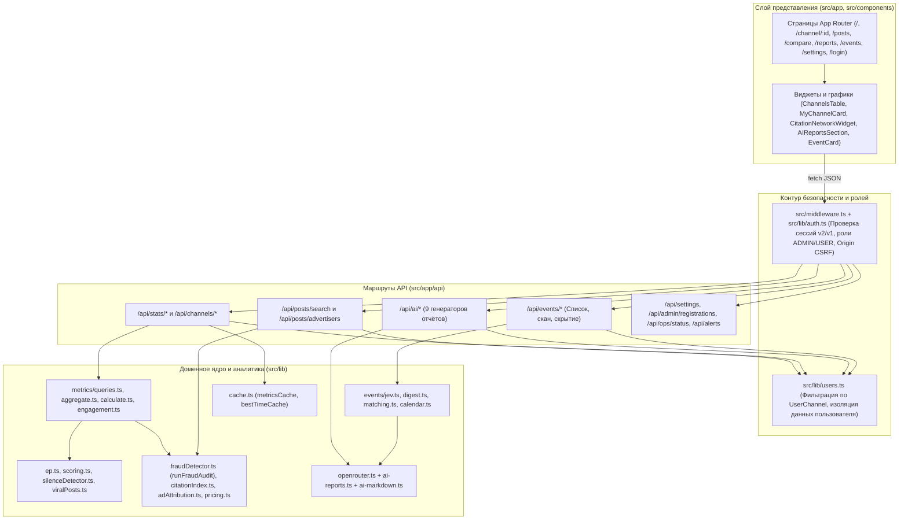
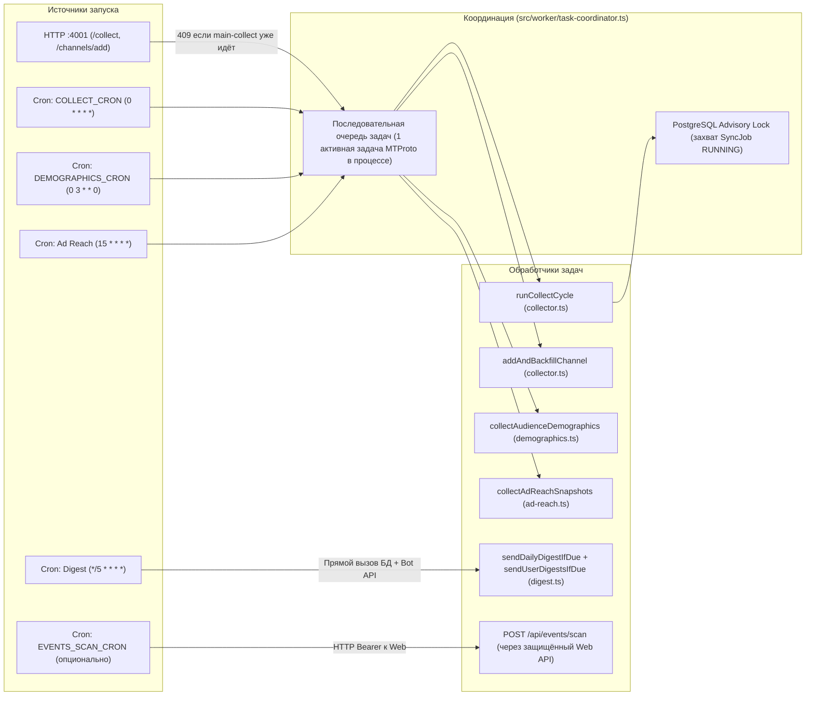
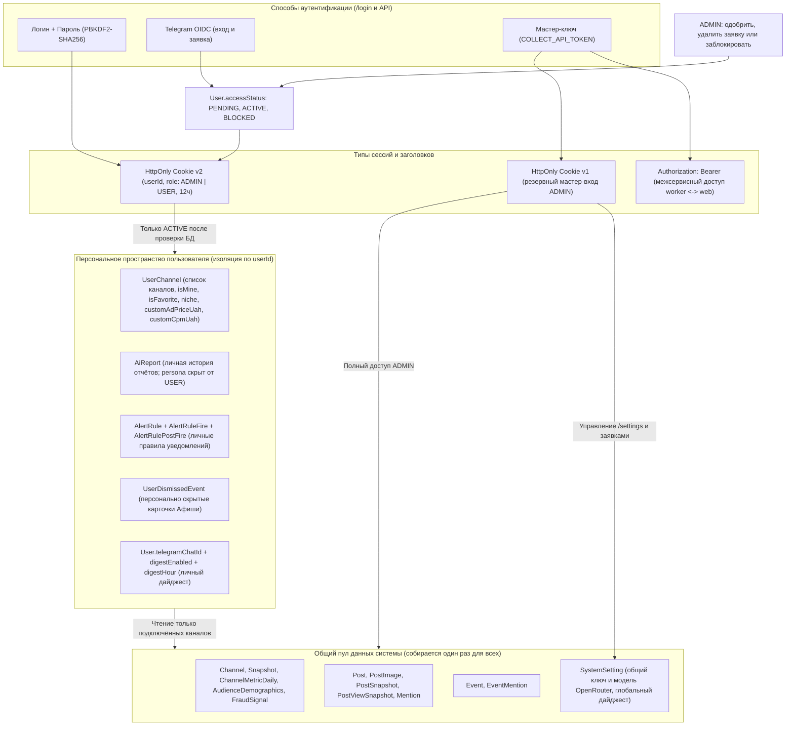
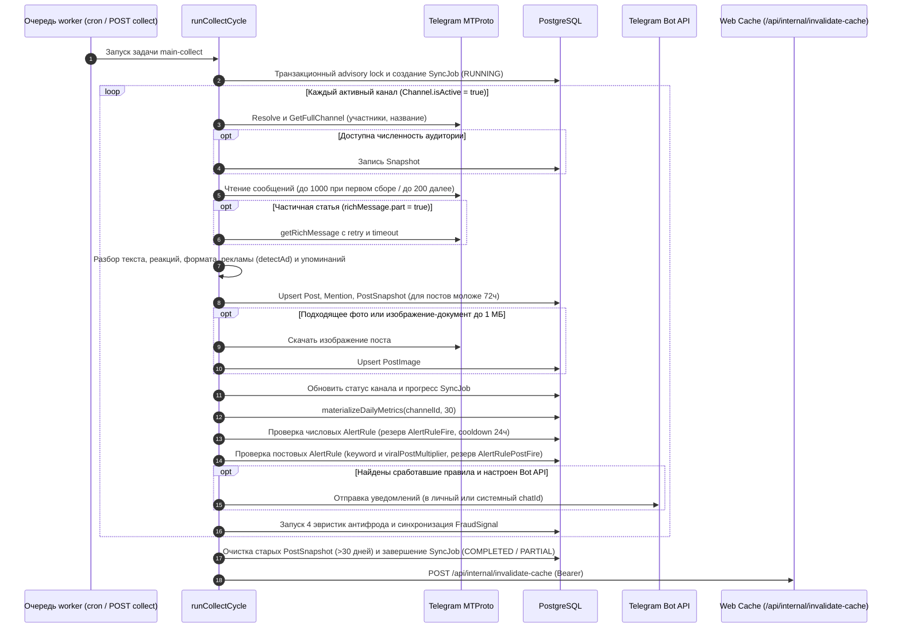
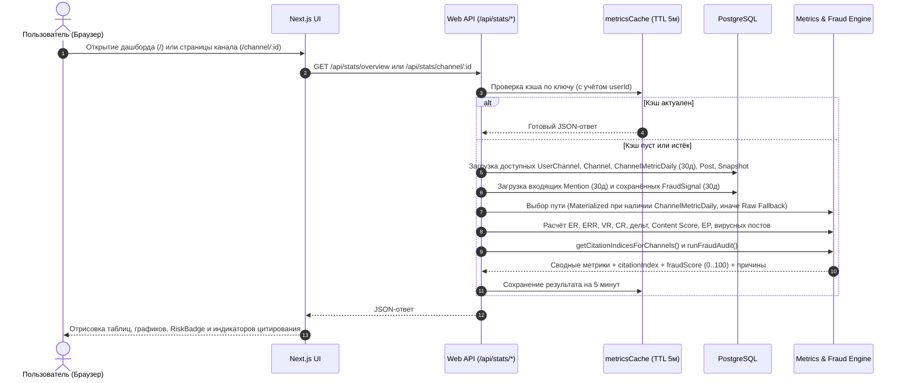
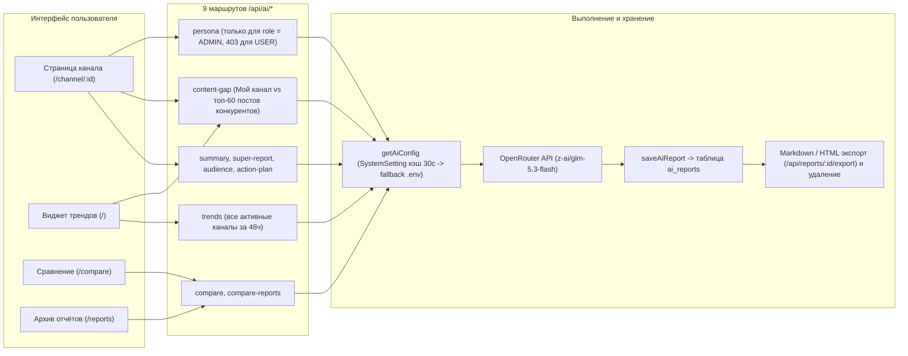
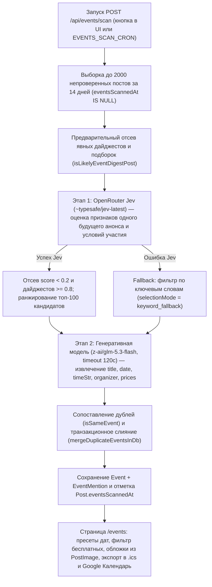

# Архитектура TgMon

Состояние реализации сверено **27 октября 2026 года**. Источники: [Prisma-схема](../prisma/schema.prisma), [база данных](database.md), [worker](../src/worker/index.ts), [коллектор](../src/worker/collector.ts), [запросы метрик](../src/lib/metrics/queries.ts) и [Compose](../docker-compose.yml).

## 1. Контекст и контейнерная архитектура

```mermaid
flowchart TB
    subgraph Users["Пользователи (Браузер)"]
        Admin["Администратор (role = ADMIN)"]
        RegularUser["Пользователь (role = USER)"]
    end

    subgraph TgMon["Система TgMon (Docker Compose / Node.js 22)"]
        subgraph WebContainer["Контейнер Web App и REST API (:4000)"]
            MW["Middleware (Cookie v2/v1, Origin CSRF, Bearer)"]
            UI["Next.js 15 App Router UI (React 19, Recharts)"]
            API["Route Handlers (/api/channels, /stats, /posts, /ai, /events, /alerts, /settings, /ops)"]
            Cache["In-memory Cache (metricsCache 5м, bestTimeCache 30м, AI config 30с)"]
        end

        subgraph WorkerContainer["Контейнер MTProto Worker (:4001)"]
            WServer["Внутренний HTTP-сервер (:4001, Bearer)"]
            Cron["Планировщики node-cron (Collect, Demographics, Ad Reach, Digest, Events Scan)"]
            Coord["TaskCoordinator (последовательная очередь задач)"]
            Collector["Сборщик teleproto (collector, fetcher, persister, retry-policy)"]
        end

        DB[("PostgreSQL 15 + pg_trgm (22 таблицы, Advisory Lock)")]
    end

    subgraph External["Внешние системы"]
        TG["Telegram MTProto API (TG_SESSION на сервере / TG_SESSION_LOCAL локально)"]
        Bot["Telegram Bot API (Алерты и дайджесты)"]
        OR["OpenRouter API (LLM z-ai/glm-5.3-flash + Jev ~typesafe/jev-latest)"]
    end

    Admin -->|HTTPS| MW
    RegularUser -->|HTTPS| MW
    MW --> UI
    MW --> API
    API <--> Cache
    API -->|Prisma ORM| DB
    API -->|Генерация 9 AI-отчётов и скан событий| OR
    API -->|POST /collect, /channels/add (Bearer)| WServer

    Cron --> Coord
    WServer --> Coord
    Coord --> Collector
    Collector -->|MTProto TCP| TG
    Collector -->|Prisma ORM + pg_try_advisory_xact_lock| DB
    Collector -->|POST /api/internal/invalidate-cache (Bearer)| API
    Collector -->|Уведомления AlertRule и дайджесты| Bot
```

Web и worker работают отдельными Node.js-процессами. Web передаёт добавление канала и ручной сбор в закрытый HTTP API worker на порту 4001 с Bearer-токеном; порт не публикуется из Compose. Только worker использует MTProto-сессию:
- На боевом сервере (`ovh-vps`) worker работает с серверной сессией `TG_SESSION` (`TgMon Server Worker`) и выполняет фоновый сбор по расписанию cron.
- Локально worker использует отдельную сессию `TG_SESSION_LOCAL` (`TgMon Local Dev`) при `--local` или `WORKER_LOCAL_MODE=true`. `npm run worker:local` отключает cron флагом `--no-cron`; `bash dev-web.sh` запускает dev Compose, где cron по умолчанию включён. Режим локальной сессии сам по себе расписания не отключает.

---

## 2. Слои приложения и компонентная схема

| Слой | Модули и ответственность |
| --- | --- |
| UI | `src/app/`, `src/components/`: страницы, интерактивные таблицы, графики, отчёты; главная и детализация загружают метрики через API |
| API | `src/app/api/`: чтение и управление каналами, статистика, AI (9 маршрутов), события, сохранённые изображения постов, удаление отчётов, настройки, алерты, дайджест, health и экспорт |
| Метрики | `src/lib/metrics/queries.ts`, `aggregate.ts`, `calculate.ts`, `engagement.ts`, `adShare.ts`; публичные реэкспорты в `src/lib/metrics.ts` |
| Производные оценки | `ep.ts`, `scoring.ts`, `fraudDetector.ts`, `citationIndex.ts`, `adAttribution.ts`, `pricing.ts`, `silenceDetector.ts`, `viralPosts.ts` |
| События и календарь | `src/lib/events/jev.ts`, `digest.ts`, `matching.ts`, `calendar.ts` (`.ics` и Google Calendar) |
| Уведомления и дайджест | `src/lib/alerts.ts`, `src/lib/digest.ts`, `src/lib/telegram.ts` |
| Сбор | `client.ts` → `fetcher.ts` → `collector.ts` → `persister.ts`; текст в `message-content.ts`, реакции в `message-reactions.ts`, упоминания в `post-mentions.ts`, изображения в `post-image.ts`, ошибки в `retry-policy.ts` |
| Дополнительные задания | `worker/demographics.ts`, `worker/ad-reach.ts` |
| Хранение и кэш | `prisma.ts`, `materialize.ts`, `cache.ts` |

### Компонентная архитектура Web & API



### Архитектура фонового Worker и координация задач



`src/worker/task-coordinator.ts` ставит основной сбор, демографию, рекламный охват и первичный backfill в одну последовательную очередь. Повторный запрос основного сбора получает 409. Создание `SyncJob` сериализовано транзакционным advisory lock PostgreSQL; активный `RUNNING` блокирует второй цикл между процессами. `RUNNING` старше порога `HEALTH_STUCK_THRESHOLD_MINUTES` (по умолчанию 120 минут) помечается `FAILED` перед новым запуском. При `SIGINT`/`SIGTERM` worker прекращает приём задач, ждёт активное задание до 30 секунд и останавливает основной сбор между каналами, завершает `SyncJob` как `PARTIAL`/`FAILED` при прерывании и отключает `TelegramClient`.

Очередь действует в одном процессе worker. Для одновременного запуска нескольких worker демография и рекламный охват потребуют отдельной межпроцессной координации; штатный Compose запускает один worker.

---

## 3. Многопользовательская изоляция и модель данных



Полная спецификация моделей PostgreSQL 15, типов полей, вторичных индексов, перечислений и каскадов приведена в документе [База данных и схема Prisma](database.md).

Схема `prisma/schema.prisma` включает **24 модели** и два перечисления: `SyncStatus` для заданий worker и `UserAccessStatus` для заявок и блокировок. Роль пользователя хранится строкой `User.role` (`ADMIN` или `USER`):

| Prisma-модель | Таблица | Назначение |
| --- | --- | --- |
| `User` | `users` | Учётные записи (`username`, необязательный `passwordHash`, `telegramSub`, `accessStatus`, `role`, настройки дайджеста) |
| `InviteCode` | `invite_codes` | Исторические коды; новая регистрация их не использует |
| `UserChannel` | `user_channels` | Персональные подписки пользователя на каналы (`isMine`, `isFavorite`, `niche`, `customAdPriceUah`, `customCpmUah`, `isActive`); unique `(userId, channelId)` |
| `UserDismissedEvent` | `user_dismissed_events` | Персонально скрытые пользователем карточки событий; unique `(userId, eventId)` |
| `Channel` | `channels` | Общий пул Telegram-каналов: идентификаторы, тип, ниша, статус и ошибки сбора |
| `Snapshot` | `snapshots` | История численности аудитории |
| `Post` | `posts` | Текущие счётчики, разбивка реакций (`reactionBreakdown`), формат (`contentType`) и текст публикации; unique `(channelId, messageId)` |
| `PostImage` | `post_images` | Одно изображение поста до 1 МБ; байты и MIME-тип хранятся отдельно от строки Post |
| `PostSnapshot` | `post_snapshots` | Нерегулярная история просмотров свежих постов для LTV |
| `PostViewSnapshot` | `post_view_snapshots` | Рекламные контрольные точки (1, 12, 24, 48 часов); unique `(postId, hoursAfterPost)` |
| `Mention` | `mentions` | Ссылка из собранного поста на `username`/`tgId`/`targetMessageId`; target не является внешним ключом на Channel |
| `SyncJob` | `sync_jobs` | Начало/конец цикла, статус (`SyncStatus`), счётчики и краткая ошибка |
| `ChannelMetricDaily` | `channel_metrics_daily` | Дневные агрегаты UTC; unique `(channelId, date)` |
| `AudienceDemographics` | `audience_demographics` | Языковые доли, доля включённых уведомлений (`notificationsEnabledPercent`), дата снимка, nullable JSONB `countryBreakdown` |
| `AiReport` | `ai_reports` | Тип (9 видов отчётов) и строковый JSON-ответ LLM, необязательный `channelId` и `userId` владельца отчёта |
| `Event` | `events` | Мероприятия и события, извлечённые из публикаций Telegram |
| `EventMention` | `event_mentions` | Связи M:N событий с исходными постами; unique `(eventId, postId)` |
| `SystemSetting` | `system_settings` | Запись `global` с общими настройками AI (`aiToken`, `aiModel`) и полями глобального дайджеста |
| `AlertRule` | `alert_rules` | Глобальные и канальные правила Telegram-уведомлений (метрики, `keyword`, `viralPostMultiplier`) с привязкой `userId` |
| `AlertRuleFire` | `alert_rule_fires` | Время последней отправки и значение для пары «правило и канал» (24ч cooldown) |
| `AlertRulePostFire` | `alert_rule_post_fires` | Фиксация отправленных постовых алертов (`keyword` и `viralPostMultiplier`) для пары «правило и пост» |
| `FraudSignal` | `fraud_signals` | Тип, значение, причина и время срабатывания эвристики |

Миграции находятся в `prisma/migrations/` (**26 миграций**). Последние миграции в репозитории:
- `20261026210800_add_user_personal_digest` — поля персонального Telegram-дайджеста в таблице `users`;
- `20261026201200_add_keyword_alert_rules` — колонка `alert_rules.keyword_query` и таблица `alert_rule_post_fires`;
- `20261026162020_add_user_channel_ad_pricing` — персональные цены рекламы `custom_ad_price_uah` и `custom_cpm_uah` в `user_channels`;
- `20261026153255_add_mention_target_message_id` — `mentions.target_message_id` для цепочек цитирования;
- `20261026132043_add_post_reaction_breakdown` — `posts.reaction_breakdown` (JSONB);
- `20261024195714_add_events_scanned_at` — `posts.events_scanned_at`.

Схема включает `pg_trgm` и GIN-индекс текста постов. Отключение канала меняет `isActive`; физическое удаление использует каскады связей Prisma. `isMine` переносится транзакцией, но уникального ограничения в БД нет. `SystemSetting.aiToken` хранится в БД; API возвращает только признак наличия и маскированное превью.

---

## 4. Основной цикл сбора, алертинга и антифрода



1. Первый сбор получает до 1000 сообщений и оставляет последние 30 дней; последующие циклы перечитывают до 200 последних сообщений без `min_id`. `lastMessageId` хранит максимум, но не ограничивает текущий запрос.
2. `FullChannel` даёт число участников. При изменении названия оно обновляется; отдельного суточного задания метаданных нет. Ошибка `FullChannel` может оставить доступный fallback-счётчик, таймаут передаётся выше.
3. После материализации worker оценивает включённые `AlertRule`:
   - для числовых метрик канала применяется cooldown 24 часа на пару «правило и канал» (`AlertRuleFire`);
   - для правил по ключевым словам (`metric = "keyword"`) и виральным постам (`metric = "viralPostMultiplier"`, превышение 30-дневной медианы просмотров в `threshold` раз при минимум 5 постах и ≥100 просмотрах) проверяются свежие посты за последние 24 часа, а отправка фиксируется однократно на пару «правило и пост» (`AlertRulePostFire`).
   - если у владельца правила задан `User.telegramChatId`, уведомление отправляется в его личный чат; иначе используется системный `TELEGRAM_CHAT_ID`. Ошибка уведомления не прерывает основной сбор.
4. Альбомы сводятся к существующему посту с тем же `groupedId`. Upsert обновляет известные счётчики, `reactionBreakdown` и текст, а `subscribersAtPublish` задаёт только при создании. Для backfill это число участников во время сбора.
5. Для постов не старше 72 часов с известными просмотрами создаётся `PostSnapshot` не чаще одного раза в 45 минут на пост. Снимки старше 30 дней удаляются ограниченными партиями в конце основного цикла. Упоминания при непустом новом списке удаляются и создаются заново; `createdAt` отражает время записи, не исходную дату публикации.
6. `postsAdded` увеличивается на обработанное сообщение, включая обновления и части альбомов. Это не число новых уникальных строк `Post`.
7. Материализация пересчитывает 30 календарных UTC-дней; её ошибка логируется отдельно. Затем общий `try/catch` обрабатывает блок антифрода: сбой в нём может пропустить оставшиеся проверки канала, но не отменяет сбор. Сигналы обновляются в пределах текущих UTC-суток и удаляются из активного 30-дневного окна, когда соответствующая проверка перестаёт срабатывать.
8. Для поста с подходящим медиа сборщик сохраняет одно фото или изображение-документ до 1 МБ в `PostImage`; у альбома сохраняется первое доступное изображение связанного поста. Ошибка загрузки изображения логируется без отмены сбора постов.

`fetcher.ts` делает паузу 1000–1299 мс перед попыткой и до трёх попыток при `FLOOD_WAIT`. Ожидание — указанное Telegram время + 2 секунды + jitter до 1499 мс; экспоненциального backoff в этом коде нет. Это задержка на вызов, а не распределённый глобальный rate limiter.

### Статьи Telegram

Пакет `telegram` установлен как npm alias для `teleproto@1.229.0` (слой API 229), преемника GramJS. Импорты и формат `StringSession` сохранены. [Причины и последствия выбора](adr/0002-telegram-rich-messages.md). Старый слой 198 возвращал новые статьи как `MessageMediaUnsupported` без текста.

`message-content.ts` преобразует `richMessage` в обычный текст с абзацами через `Rich.toPlainText`: заголовки, списки, таблицы, цитаты и подписи медиа. Изображения внутри статей не извлекаются, OCR и воспроизведение оформления Telegram не выполняются. Отдельные фото постов сохраняет `post-image.ts`. Для `part=true` полный текст догружается через `getRichMessage` с существующими ограничением частоты, повторными попытками и таймаутом. Ошибка догрузки изолирована: счётчики поста сохраняются, прежние текст, рекламная классификация и упоминания не перезаписываются неполным результатом.

Полный текст сохраняется в существующее `Post.text`; миграция БД не нужна. Он доступен интерфейсу, поиску, рекламной классификации и новым AI-отчётам в пределах их существующих выборок и лимитов длины. Старые отчёты автоматически не пересчитываются. Восстановление пустых записей за пределами последних 200 сообщений описано в [инструкции утилиты](../scripts/README.md#восстановление-текста-статей).

### Ошибки основного цикла

`retry-policy.ts` увеличивает `consecutiveErrors` и отключает канал при достижении `CHANNEL_MAX_CONSECUTIVE_ERRORS` (по умолчанию 10). Успех сбрасывает счётчик. При `TelegramTimeoutError` цикл пытается переподключить клиент; неудачный reconnect завершает цикл с fatal error. Некоторые ошибки чтения сообщений внутри `collectChannelData` только логируются, поэтому успешный статус не гарантирует полноту постов.

---

## 5. Материализация, чтение API, кэш и гибридный антифрод



API предпочитает `ChannelMetricDaily`, если за период есть хотя бы одна строка; иначе использует сырые `Snapshot`/`Post`. Worker рассчитывает дневные агрегаты, web — сводные метрики, EP, Content Score, CI и динамический антифрод. Это не модель «worker только пишет сырые данные».

`metricsCache` живёт 5 минут, `bestTimeCache` — 30 минут. Кэш находится в памяти одного процесса. API добавления, `PATCH`/`DELETE` канала, ручного сбора и внутренней инвалидации очищают оба кэша. `PUT` избранного их не очищает. Перезапуск процесса очищает кэш; общего кэша между репликами нет.

В `finally` основного цикла worker отправляет запрос на `WEB_INTERNAL_URL` с `COLLECT_API_TOKEN`, если оба заданы. Сетевое исключение логируется; текущий caller не проверяет HTTP-статус ответа.

### Гибридный антифрод

Worker анализирует до 30 дневных строк и до 30 последних постов, сохраняет только сработавшие сигналы. При чтении `overview`/`detail` web загружает сигналы за 30 дней и вызывает чистую функцию `runFraudAudit`; сама она не читает БД. Сохранённый сигнал соответствующего типа имеет приоритет перед повторным вычислением этого типа.

При отсутствии сохранённых сигналов расчёт использует переданные данные. Overview передаёт посты за 7 дней и дневные метрики за 30 дней; detail — последние 20 постов (либо `recentPosts` при короткой выборке) и сырую историю аудитории выбранного периода. Даты упоминаний эти вызовы не передают, поэтому динамическая проверка скачков не эквивалентна фоновой. [Формулы и ограничения](analytics-formulas.md), [ADR](adr/0001-anti-fraud-detection-architecture.md).

---

## 6. Демография, рекламный охват и ежедневные дайджесты

- **Демография**: `DEMOGRAPHICS_CRON`, default `0 3 * * 0`; только активные `isMine` broadcast-каналы без успешного снимка с начала текущей недели (воскресенье 00:00 по часовому поясу процесса). Проверка `canViewStats`, вызовы `GetBroadcastStats`/`LoadAsyncGraph` в `statsDc`, разбор последней общей точки и доли включённых уведомлений (`notificationsEnabledPercent`). Ошибки изолированы от основного сбора. `countryBreakdown` остаётся SQL `NULL`.
- **Рекламный охват**: фиксированный cron `15 * * * *`, посты с `isAd: true` не старше 50 часов. Фильтра `channel.isActive` здесь нет. Проверяются отсутствующие точки 1/12/24/48 часов с допуском 5 минут до срока. Все просроченные точки получают текущие просмотры; фактическое время хранится в `capturedAt`.
- **Ежедневные Telegram-дайджесты**: вне локального режима worker каждые 5 минут (`*/5 * * * *`) вызывает:
  1. `sendDailyDigestIfDue()` — глобальный дайджест из `SystemSetting` (отправляется на системный `TELEGRAM_CHAT_ID` в выбранный час UTC по всем активным каналам);
  2. `sendUserDigestsIfDue()` — персональные дайджесты для всех пользователей с `User.digestEnabled = true` и непустым `User.telegramChatId` в их `User.digestHour` UTC строго по их активным `UserChannel`. Повторная отправка в те же UTC-сутки блокируется через `lastDigestAt`.
- Дополнительные задания не запускаются автоматически при старте: `COLLECT_ON_STARTUP` относится только к основному циклу.

Тепловые карты канала, почасовое распределение и рекомендация времени публикации используют `APP_TIMEZONE` (по умолчанию `Europe/Moscow`) независимо от часового пояса процесса. Cron по-прежнему использует часовой пояс Node.js-процесса; материализация использует UTC.

---

## 7. AI-отчёты и двухэтапный сканер событий («Афиша»)

### Пайплайн генерации AI-отчётов



AI-обработчики формируют промпты из сохранённых данных, вызывают `callOpenRouter` и сохраняют ответ через `saveAiReport`. Девять типов отчётов описаны в [API](api-reference.md). Отчёт `persona` («Психологический портрет») защищён проверкой роли: он виден в UI и доступен на сервере только администратору (`role = 'ADMIN'`). Для анализа рыночных трендов (`/api/ai/trends`) берутся все активные каналы из списка пользователя за последние 48 часов, до 10 текстовых постов на канал. Для анализа упущенных тем конкурентов (`/api/ai/content-gap`) сопоставляются до 40 последних текстовых постов «Моего канала» и топ-60 наиболее эффективных постов активных конкурентов за выбранный период (по умолчанию 14 дней).

### Двухэтапный пайплайн сканера событий и «Афиши»



`callOpenRouter` использует ключ и модель из `SystemSetting`, затем резервные `OPENROUTER_API_KEY` и `z-ai/glm-5.3-flash`. Jev использует тот же ключ и фиксированную модель `~typesafe/jev-latest`. Конфигурация кэшируется на 30 секунд в процессе web и сбрасывается при сохранении настроек в том же процессе. `DELETE /api/reports/:id` физически удаляет выбранный `AiReport`, после чего его страница и HTML-экспорт недоступны. Изображение для карточки «Афиши» выбирается из видимых упоминаний и выдаётся отдельным маршрутом `/api/posts/:id/image`, без передачи байтов в списке событий. На карточке события доступны скачивание `.ics` (RFC 5545) и добавление в Google Календарь (`src/lib/events/calendar.ts`).

---

## 8. Граница доступа и безопасность Middleware

Middleware (`src/middleware.ts`) проверяет `Bearer` для сервисных запросов либо подписанную `HttpOnly`-cookie Web UI (`v2` с `userId` и `role` либо `v1` при резервном мастер-входе). Для пользовательской cookie middleware в Node.js runtime дополнительно читает текущие роль и `User.accessStatus` из БД. `PENDING` видит только страницу ожидания, `BLOCKED` теряет доступ с действующей cookie. Сессия действует 12 часов и не содержит секретный ключ. Cookie-мутации требуют совпадающий `Origin`; `/api/internal/*` принимает только `Bearer`. Заявками управляет `ADMIN` через `/api/admin/registrations`; данные каналов, отчётов, алертов и скрытых событий изолированы по `userId`. [Эксплуатация](deployment.md).
