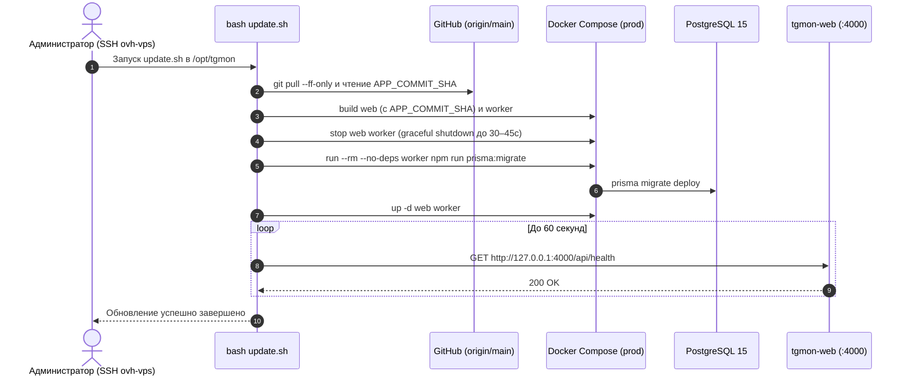

# Запуск и эксплуатация

Сверено **27 октября 2026 года** с [package.json](../package.json), [dev-web.sh](../dev-web.sh), [update.sh](../update.sh), [Compose](../docker-compose.yml), [prod override](../docker-compose.prod.yml), [dev override](../docker-compose.dev.yml), [Dockerfile.web](../Dockerfile.web), [Dockerfile.worker](../Dockerfile.worker) и [CI](../.github/workflows/ci.yml).

## Среды проекта и изоляция Telegram-авторизации (`AuthKeyDuplicated`)

```mermaid
flowchart TB
    subgraph LocalEnv["1. Локальная среда разработки (Windows C:\TgMon / WSL)"]
        DevCompose["docker-compose.yml + docker-compose.dev.yml (Hot Reload)"]
        LocalWeb["tgmon-web (:4000, npm run dev)"]
        LocalWorker["tgmon-worker (:4001, WORKER_LOCAL_MODE=true)"]
        LocalDB[("tgmon-postgres (:5432)")]
        LocalSession["Локальный .env: TG_SESSION_LOCAL (устройство TgMon Local Dev)"]
        DevCompose --> LocalWeb
        DevCompose --> LocalWorker
        DevCompose --> LocalDB
        LocalSession --> LocalWorker
    end

    subgraph ProdEnv["2. Боевой сервер OVH (ovh-vps, /opt/tgmon, tgmons.online)"]
        Nginx["Nginx Reverse Proxy (HTTPS + Let's Encrypt)"]
        ProdCompose["docker-compose.yml + docker-compose.prod.yml"]
        ProdWeb["tgmon-web (:4000, production build)"]
        ProdWorker["tgmon-worker (:4001, полный cron + дайджесты)"]
        ProdDB[("tgmon-postgres (127.0.0.1:5432)")]
        ProdSession["Серверный .env: TG_SESSION (устройство TgMon Server Worker)"]
        Nginx --> ProdWeb
        ProdCompose --> ProdWeb
        ProdCompose --> ProdWorker
        ProdCompose --> ProdDB
        ProdSession --> ProdWorker
    end

    subgraph GitHubCI["3. GitHub (liquidsyntes/tg_mons, origin/main)"]
        CI["GitHub Actions CI (prisma generate, tsc, eslint, vitest, next build)"]
    end

    TGCloud["Серверы Telegram MTProto"]

    LocalWorker -->|Свой независимый auth_key| TGCloud
    ProdWorker -->|Свой независимый auth_key| TGCloud
    LocalEnv -->|git push origin main (без секретов)| GitHubCI
    GitHubCI -->|git pull --ff-only (update.sh)| ProdEnv
```

Проект эксплуатируется в **трёх чётко разделённых средах**, которые нельзя смешивать:

| Среда | Где находится | Как запускается | Какая MTProto-сессия используется | Как отображается в Telegram («Устройства») |
| --- | --- | --- | --- | --- |
| **1. Локальная разработка** | Windows (`C:\TgMon`) / WSL (`/mnt/c/TgMon`) | В Docker с Hot Reload: `docker compose -f docker-compose.yml -f docker-compose.dev.yml up -d` (или `bash dev-web.sh`) — контейнеры `tgmon-postgres` + `tgmon-web` + `tgmon-worker` | Только **`TG_SESSION_LOCAL`** (`WORKER_LOCAL_MODE=true`) | `TgMon Local Dev` |
| **2. Боевой сервер (Production)** | VPS OVH (`ovh-vps`, `/opt/tgmon`, домен `tgmons.online`) | Полный Docker-стек (`postgres` + `web` + `worker`) + Nginx + HTTPS, деплой через `bash update.sh` | Только **`TG_SESSION`** (`docker-compose.prod.yml`) | `TgMon Server Worker` |
| **3. GitHub** | `origin/main` (`liquidsyntes/tg_mons`, публичный репозиторий) | CI (`tsc`, `eslint`, `vitest`, `build`) | Секреты и строки сессий в git **никогда не хранятся** | — |

### Почему разделены `TG_SESSION` и `TG_SESSION_LOCAL`

В протоколе Telegram MTProto один аккаунт (номер телефона и пара `TG_API_ID` / `TG_API_HASH`) может иметь сколько угодно параллельных активных сессий — так же, как одновременно работают Telegram на телефоне и ноутбуке. Однако если **одна и та же строка сессии (`auth_key`)** будет одновременно запущена с двух разных IP-адресов (например, на сервере OVH и на локальном ПК), Telegram немедленно выбросит ошибку **`AuthKeyDuplicated`** и принудительно сбросит авторизацию везде.

Поэтому действует жёсткое правило:
1. **Серверная сессия (`TG_SESSION`)** живёт **только на сервере OVH** (в `/opt/tgmon/.env`). Никогда не копируйте её на локальную машину.
2. **Локальная сессия (`TG_SESSION_LOCAL`)** создаётся отдельно один раз на локальной машине командой `npm run auth:local` или `npm run auth:local:qr` и хранится только в локальном `.env`.
3. В коде [src/worker/client.ts](../src/worker/client.ts) при запуске в локальном режиме (`npm run worker:local`, флаг `--local` или `WORKER_LOCAL_MODE=true`) воркер **игнорирует `TG_SESSION`** и требует именно `TG_SESSION_LOCAL`. Даже если в локальном `.env` случайно осталась строка `TG_SESSION`, локальный воркер к ней не прикоснётся.

---

## Требования и подготовка

- Node.js 22 и npm — версия Node совпадает с Docker и CI.
- PostgreSQL 15+ с расширением `pg_trgm`. SQLite не поддерживается.
- Для сбора — Telegram `TG_API_ID` / `TG_API_HASH` и MTProto-сессия (`TG_SESSION_LOCAL` локально, `TG_SESSION` на сервере).
- Все команды выполняются из корня проекта (`C:\TgMon` в Windows или `/mnt/c/TgMon` в WSL). Prisma Client генерируется под целевую ОС.

```bash
npm ci
cp .env.example .env
```

### Как пройти авторизацию MTProto локально (`TG_SESSION_LOCAL`)

Для локальной машины предусмотрены два способа выпустить изолированную сессию `TG_SESSION_LOCAL`:

1. **Через QR-код в браузере (рекомендуемый, без SMS и кодов подтверждения)**:
   ```bash
   npm run auth:local:qr
   ```
   - Скрипт поднимет временную локальную страницу **`http://localhost:4099`** с графическим QR-кодом (обновляется автоматически каждые 30 секунд).
   - Откройте `http://localhost:4099` в браузере на ПК.
   - На телефоне откройте **Telegram → Настройки → Устройства → Подключить устройство** и наведите камеру телефона на QR-код на мониторе.
   - **Важный нюанс**: не пытайтесь открывать сырую ссылку `tg://login?token=...` прямым кликом в браузере или терминале — Telegram специально блокирует прямые клики по `tg://login` защитной заглушкой *«Ваша версия Telegram устарела»*. Авторизация проходит именно при сканировании картинки QR-кода камерой из мобильного приложения.
   - Если на аккаунте включён облачный пароль 2FA, введите его прямо в появившееся поле на странице `http://localhost:4099` (или в терминале).
   - После успеха сессия автоматически запишется в `.env` в переменную `TG_SESSION_LOCAL`.

2. **Через телефон и код подтверждения в терминале**:
   ```bash
   npm run auth:local
   ```
   Запросит номер телефона, код из Telegram и пароль 2FA (если включён), после чего сохранит `TG_SESSION_LOCAL` в `.env`.

Для генерации серверной переменной `TG_SESSION` используются `npm run auth` либо неинтерактивные серверные скрипты в `scripts/auth/` (`qr-auth.ts`, `auth-file.ts`).

## Переменные окружения

| Переменная | Потребитель | Default / смысл |
| --- | --- | --- |
| DATABASE_URL | Prisma, web, worker | URL PostgreSQL; локально `127.0.0.1:5432/tgmon`, внутри Compose — `postgres:5432/tgmon` |
| POSTGRES_PASSWORD | docker-compose.prod.yml | Пароль БД для production-контейнера PostgreSQL (обязателен в `.env` на сервере) |
| TG_API_ID, TG_API_HASH | auth, MTProto | Ключи приложения Telegram (`my.telegram.org`) |
| TG_PHONE | auth | Телефон; при отсутствии CLI запросит его |
| TG_SESSION | серверный worker и `npm run auth` | Серверная MTProto-сессия (`TgMon Server Worker`); локально не используется |
| TG_SESSION_LOCAL | локальный worker (`worker:local`) и `auth:local` | Изолированная локальная MTProto-сессия (`TgMon Local Dev`), исключающая `AuthKeyDuplicated` |
| WORKER_LOCAL_MODE | worker | При `true` (или флаге `--local`) использует строго `TG_SESSION_LOCAL`; сам по себе cron не отключает |
| WORKER_DISABLE_CRON | worker | При `true` отключает расписания cron и `COLLECT_ON_STARTUP`, оставляя только внутренний API (`:4001`) для запросов из UI |
| COLLECT_API_TOKEN | вход Web UI (мастер-ключ), подпись cookie сессий, Bearer для worker | Непустой сильный случайный ключ; без него вход и защищённые маршруты недоступны |
| COLLECT_CRON | worker | `0 * * * *`; невалидное значение заменяется этим default с логом |
| COLLECT_ON_STARTUP | worker | Запуск только если значение строго `true`; при `WORKER_DISABLE_CRON=true` или `--no-cron` не выполняется |
| DEMOGRAPHICS_CRON | worker | `0 3 * * 0`; при невалидном значении weekly fallback |
| EVENTS_SCAN_CRON | worker | Необязательное UTC-расписание сканера событий, например `30 */6 * * *`; пустое значение отключает фоновый запуск. Локальный режим и WORKER_DISABLE_CRON также отключают его |
| WEB_INTERNAL_URL | worker | Адрес web для сброса кэша; в Compose `http://web:4000`, локально `http://localhost:4000` |
| WORKER_INTERNAL_URL | web | Адрес закрытого API worker; в Compose `http://worker:4001`, локально `http://localhost:4001` |
| WORKER_INTERNAL_HOST, WORKER_INTERNAL_PORT | worker | По умолчанию `127.0.0.1:4001`; Compose привязывает `0.0.0.0:4001` только внутри своей сети |
| TELEGRAM_REQUEST_TIMEOUT_MS | fetcher в worker и CLI-утилитах | 30000 мс |
| CHANNEL_MAX_CONSECUTIVE_ERRORS | retry-policy | 10; отключение при достижении порога |
| TELEGRAM_BOT_TOKEN, TELEGRAM_CHAT_ID | worker | Отправка пользовательских AlertRule и уведомлений об автоотключении; без обоих значений правила сохраняются, но не отправляются |
| OPENROUTER_API_KEY | web AI/scanner | Общий резервный ключ для генеративных отчётов и сканера событий (включая Jev); также задаётся администратором через `/settings` |
| APP_TIMEZONE | web | IANA-часовой пояс тепловых карт, почасового распределения и рекомендации публикации; по умолчанию `Europe/Moscow` |
| APP_COMMIT_SHA | web | SHA исходного коммита для подписи версии в шапке. `update.sh` выставляет его после `git pull`; локальный dev читает `.git/HEAD` без этой переменной |
| HEALTH_STUCK_THRESHOLD_MINUTES | web health и захват SyncJob в worker | 120; Compose передаёт одинаковое значение обоим сервисам |
| HEALTH_STALE_THRESHOLD_MINUTES | web health | 720; Compose передаёт в web |
| MY_CHANNEL_USERNAME | Никем не читается | Сохранён в примере, но не назначает «Мой канал» |

---

## Режим 1: Локальный Docker-стек (`dev-web.sh`)

Штатный локальный запуск использует `docker-compose.yml` вместе с `docker-compose.dev.yml`: PostgreSQL, web с Hot Reload и worker с `TG_SESSION_LOCAL`. Перед первым запуском соберите образы:

```bash
docker compose -f docker-compose.yml -f docker-compose.dev.yml up -d --build
```

При повторном запуске можно использовать `bash dev-web.sh`. Скрипт пытается остановить локальный PostgreSQL в WSL, если порт 5432 занят, предупреждает об отсутствии `TG_SESSION_LOCAL`, выполняет `docker compose ... up -d` **без `--build`** и запускает `npx prisma migrate deploy` на хосте. Для последней команды `DATABASE_URL` из локального `.env` должен указывать на доступный с хоста PostgreSQL. Скрипт не проверяет успешность сбора Telegram-данных.

Dev Compose запускает worker с `--local` и `WORKER_LOCAL_MODE=true`, поэтому он использует только `TG_SESSION_LOCAL`. При отсутствии сессии контейнер всё равно стартует, но MTProto-сбор не сможет авторизоваться. `WORKER_DISABLE_CRON` в dev Compose по умолчанию `false`: расписания основного сбора, демографии и рекламного охвата остаются включёнными; дайджест и автоматическое сканирование событий в локальном режиме не планируются. Для режима только по запросу задайте `WORKER_DISABLE_CRON=true`.

Если PostgreSQL уже запущен и нужен ручной запуск Node.js без Docker, доступна команда `npm run dev:local`: она запускает web и `worker:local` с `--local --no-cron`. Этот вариант требует корректного `DATABASE_URL`, локальной сессии для MTProto-операций и свободных портов 4000/4001.

---

## Режим 2: Production-развёртывание на сервере OVH (`update.sh` и полный Docker Compose)

На боевом сервере (`ovh-vps`, каталог `/opt/tgmon`, домен `tgmons.online`) работает полный стек в Docker (`postgres` + `web` + `worker`) с обратным прокси Nginx и сертификатами Let's Encrypt (`issue-cert.sh`).

### Штатное обновление сервера

На сервере в `/opt/tgmon` обновление выполняется скриптом [update.sh](../update.sh):
```bash
bash update.sh
```

Скрипт передаёт текущий SHA в сборку web-образа. В шапке показываются его первые семь символов (`v. abc1234`). При ручной сборке образа без `update.sh` передайте `APP_COMMIT_SHA` из того же checkout; иначе шапка покажет `v. н/д`. В локальном dev-контейнере версия читается из смонтированной `.git` и обновляется после нового коммита при перезагрузке страницы.

Скрипт последовательно выполняет:
1. `git pull --ff-only` из `origin/main`.
2. `docker compose -f docker-compose.yml -f docker-compose.prod.yml build web worker`.
3. Остановка `web` и `worker`.
4. Применение миграций БД: `docker compose -f docker-compose.yml -f docker-compose.prod.yml run --rm --no-deps worker npm run prisma:migrate`.
5. Запуск обновлённых `web` и `worker`, затем ожидание ответа `/api/health` до 60 секунд.



В `.env` на сервере обязательно должны быть заданы `POSTGRES_PASSWORD`, `COLLECT_API_TOKEN`, `TG_API_ID`, `TG_API_HASH`, серверная `TG_SESSION` и `WEB_INTERNAL_URL=http://web:4000`.

---

## Режим 3: Ручная пересборка локальных образов

После изменений файлов, которые включаются в образы, пересоберите затронутые сервисы через Compose. Для полного первого запуска:

```bash
docker compose -f docker-compose.yml -f docker-compose.dev.yml up -d --build
```

Dev override монтирует исходный код в web и worker, запускает `npm run dev` и `npx tsx watch src/worker/index.ts --local`. Не запускайте одновременно web на хосте и в контейнере: оба используют порт 4000.

## Порт 4000 и диагностика

TgMon работает на `http://localhost:4000/`. На этом порту не должен висеть другой процесс.

```bash
curl -i http://localhost:4000/
curl -i http://localhost:4000/api/health
```

Если порт занят или браузер открывает старый процесс: в WSL проверьте `ss -ltnp 'sport = :4000'`, в PowerShell — `Get-NetTCPConnection -State Listen -LocalPort 4000`.

## Миграции и демонстрационные данные

- `npm run prisma:migrate` выполняет **prisma migrate deploy**: применяет существующие миграции из `prisma/migrations/`, не создаёт новые.
- `npm run prisma:generate` обновляет Prisma Client, не меняя БД. `npm run build` также запускает генерацию перед Next build.
- `npm run prisma:push` синхронизирует схему без истории миграций; не используйте его как обычную процедуру обновления существующей БД.
- `npm run seed` удаляет посты, снимки и каналы, затем создаёт демонстрационные данные. Только для отдельной тестовой базы!
- Для Windows `EPERM` при `prisma generate` проверьте запущенные Node-процессы этого проекта, которые могут удерживать Prisma Query Engine, и остановите их перед генерацией.

Актуальные миграции включают:
- `20261020150000_add_multiuser_support` — таблицы многопользовательского режима (`users`, `invite_codes`, `user_channels`, `user_dismissed_events`) и привязка `user_id` в `ai_reports` и `alert_rules`.
- `20261016000000_add_post_images` — таблица `post_images` для хранения сжатых изображений постов.
- `20261013212052_add_event_dismissed_at` — колонка `events.dismissed_at`.

## Многопользовательская система, инвайты и доступ к Web UI

В TgMon реализована **многопользовательская система с регистрацией по инвайтам (Вариант А)**:

1. **Три способа авторизации**:
   - **Вход по логину и паролю (`/login` → вкладка «Вход»)**: проверяет учётную запись в таблице `users` (хеширование паролей PBKDF2-SHA256) и выдаёт подписанную `HttpOnly`-cookie сессии формата `v2.<userId>.<role>.<expiresAt>.<nonce>.<sig>` на 12 часов.
   - **Регистрация по инвайт-коду (`/login` → вкладка «По инвайту» или ссылка `/login?invite=TGMON-...`)**: создать аккаунт без действующего инвайт-кода нельзя. При первой регистрации администратора (или первом входе по мастер-ключу) все ранее созданные в системе каналы, AI-отчёты и правила уведомлений автоматически привязываются к этому администратору (`claimOrphanedDataForAdmin`).
   - **Резервный вход по мастер-ключу (`/login` → вкладка «Мастер-ключ»)**: ввод `COLLECT_API_TOKEN` из `.env`. Если в базе уже есть пользователь с ролью `ADMIN`, создаёт сессию `v2` от его имени; иначе создаёт совместимую сессию `v1` с правами `ADMIN`. Межсервисные запросы (`worker <-> web`) используют заголовок `Authorization: Bearer <COLLECT_API_TOKEN>`.

2. **Как разделены данные между пользователями**:
   - **Общий слой сбора**: таблицы `channels`, `posts`, `post_images`, `snapshots`, `channel_metrics_daily`, `events`, `fraud_signals` общие. Воркер собирает каждый Telegram-канал один раз, даже если на него подписаны 10 разных пользователей.
   - **Персональное рабочее пространство каждого пользователя**:
     - Свой список отслеживаемых каналов, свой выбор «Моего канала» (`isMine`) и «Избранного» (`isFavorite`) в таблице `user_channels`.
     - Если пользователь добавляет канал, который уже есть в БД у другого пользователя, он мгновенно подключается к его списку с уже собранной историей.
     - При удалении канала пользователем без `permanent=true` отключается только его личная подписка (`UserChannel.isActive = false`), не ломая мониторинг другим пользователям. Полное физическое удаление из БД (`DELETE /api/channels/:id?permanent=true`) доступно только роли `ADMIN`.
     - Свои AI-отчёты (`AiReport.userId`), свои правила алертов (`AlertRule.userId`) и свои персонально скрытые карточки в «Афише» (`UserDismissedEvent`).

3. **Управление инвайтами и общим ключом OpenRouter (`/settings`)**:
   - Ключ OpenRouter (`SystemSetting.aiToken` / `OPENROUTER_API_KEY`) является **общим** для всех приглашённых пользователей — им не нужно вводить собственные ключи для генерации AI-отчётов.
   - Просмотр и изменение настроек OpenRouter, а также создание и отзыв инвайт-кодов (`/api/invites`, блок «Многопользовательский доступ (Инвайты)» на странице `/settings`) доступны **только пользователям с ролью `ADMIN`**. Обычные пользователи (`USER`) на странице `/settings` управляют своим персональным ежедневным Telegram-дайджестом и своими правилами уведомлений (`AlertRule`).

4. **Обратный прокси (Nginx)**:
   - Направляйте upstream на `http://127.0.0.1:4000`, передавайте `Host` и `X-Forwarded-Proto=https`, чтобы cookie получала флаг `Secure`, а CSRF-проверка `Origin` корректно сверяла внешний домен (`tgmons.online`). Таймауты прокси должны учитывать синхронный сбор и генерацию AI-отчётов (до 60–120 секунд).

## Проверка после запуска

```bash
docker compose ps
curl -i http://localhost:4000/api/health
```

```mermaid
flowchart TD
    Req["GET /api/health"] --> DBCheck{"SELECT 1 в PostgreSQL успешен?"}
    DBCheck -->|Нет| ErrDB["503 Service Unavailable (Database error)"]
    DBCheck -->|Да| ActiveCh{"Есть активные каналы (Channel.isActive = true)?"}
    ActiveCh -->|Нет| Idle["200 OK (status: idle)"]
    ActiveCh -->|Да| HasSync{"Есть хотя бы один SyncJob в БД?"}
    HasSync -->|Нет| InitWin{"Прошло <= 720 мин со старта web или создания канала?"}
    InitWin -->|Да| Init["200 OK (status: initializing)"]
    InitWin -->|Нет| StaleInit["503 Service Unavailable (sync job stale)"]
    HasSync -->|Да| RunningCheck{"Последний SyncJob в статусе RUNNING?"}
    RunningCheck -->|Да, старше 120 мин| Stuck["503 Service Unavailable (sync job stuck)"]
    RunningCheck -->|Да, <= 120 мин| HealthyRun["200 OK (status: healthy, RUNNING)"]
    RunningCheck -->|Нет (завершён)| AgeCheck{"С момента завершения прошло > 720 мин?"}
    AgeCheck -->|Да| Stale["503 Service Unavailable (sync job stale)"]
    AgeCheck -->|Нет| HealthyDone["200 OK (status: healthy; проверять lastSyncStatus и channelsFailed)"]
```

Логи нужного сервиса можно изучить локально через `docker compose logs --tail=100 worker` или `web`; они могут содержать данные каналов, поэтому перед публикацией их нужно обезличить.

Health проверяет соединение с БД через `SELECT 1`. Без активных каналов он возвращает 200 `idle`. Если активные каналы есть, но SyncJob ещё нет, в пределах 720 минут с запуска web или создания самого раннего активного канала возвращается 200 `initializing`; после этого 503 `sync job stale`. Перезапуск web начинает это окно ожидания заново. Зависший незавершённый цикл старше 120 минут и завершённый старше 720 минут при активных каналах дают 503. Недоступная БД также даёт 503. **Свежий FAILED/PARTIAL может вернуть 200**: проверяйте lastSyncStatus и channelsFailed в теле. UI отдельно считает канал stale после 3 часов.

При `COLLECT_ON_STARTUP=false` перезапуск worker не создаёт новый SyncJob: health до следующего цикла показывает прежний результат. Для проверки нового сборщика дождитесь cron или выполните один ручной сбор кнопкой в UI / `POST /api/collect/run`; второй одновременный запуск получит 409. Проверяйте `result.successCount/errorCount`, затем `lastSyncStatus=COMPLETED` и `channelsFailed=0`. Сам ответ `success:true` не гарантирует успех всех каналов.

При остановке worker новые задачи отклоняются, активному заданию даётся до 30 секунд; основной сбор останавливается между каналами. Если он не завершился, текущий SyncJob переводится в PARTIAL или FAILED и TelegramClient отключается. Compose задаёт `stop_grace_period: 45s`, чтобы Docker не прервал эту процедуру раньше времени.

Проверьте доступность главной, добавленного канала и последних метрик. Отсутствие демографии не обязательно ошибка запуска: задание недельное и требует canViewStats. Рекламные точки появляются отдельным cron в :15, если найдены подходящие isAd-посты. Ни демография, ни рекламный сбор не выполняются startup-триггером основного цикла.

## Восстановление ранее пустых статей

После обновления обоих образов утилита читает старые пустые посты по ID, даже если они уже вне последних 200 сообщений. N — внутренний ID канала TgMon. Сначала выполните проверку:

```bash
docker compose exec worker npx tsx scripts/backfill-articles.ts --channel-id=N
```

Проверьте `recoverable` и `unavailable`, затем выполните сохранение:

```bash
docker compose exec worker npx tsx scripts/backfill-articles.ts --channel-id=N --apply
```

Обновляются только пустые тексты статей, их рекламная классификация и упоминания. Миграций, пересоздания постов и изменения счётчиков нет. Для больших выборок используйте `--limit` и `--after-id` по [инструкции](../scripts/README.md#восстановление-текста-статей). Не все пустые сообщения являются статьями; обычные медиа без подписи не получат вымышленный текст.

Утилита не сбрасывает web-кэш. После записи дождитесь его истечения (метрики — 5 минут), вызовите штатный `POST /api/internal/invalidate-cache` с Bearer-токеном из защищённого окружения либо проверьте после следующего успешного основного сбора. Не вставляйте реальный токен в документацию или общий терминальный лог. Поиск `/api/posts/search` не кэшируется этим кэшем.

Повторный dry-run не должен вновь предлагать уже восстановленные статьи. Откройте публикацию в TgMon, проверьте полный текст и прокрутку на десктопной и мобильной ширине. Сохранённые AI-отчёты не переписываются; нужные отчёты создайте заново через UI.

## AI и настройки

Для генерации задайте ключ на `/settings` или OPENROUTER_API_KEY web-процессу. `callOpenRouter` использует сохранённую модель либо `z-ai/glm-5.3-flash`, JSON response format и timeout 60 секунд; scanner использует 120 секунд. Перед извлечением событий Jev вызывается через OpenRouter Decisions API с тем же ключом и моделью `~typesafe/jev-latest`: до 2000 постов за запуск, до 10 постов за запрос, не более четырёх одновременных запросов, таймаут каждого 15 секунд, повтор при 429/529. При недоступности Jev сканер использует прежний отбор по ключевым словам и сообщает об этом в интерфейсе. Посты отправляются внешнему провайдеру при ручном сканировании. Фактическая доступность моделей зависит от провайдера. Сохранённые ключ и модель применяются к запросам OpenRouter. Jev использует сохранённый или резервный ключ и модель `~typesafe/jev-latest`. Кэш настроек живёт до 30 секунд в каждом web-процессе; сохранение сбрасывает кэш текущего процесса.

При заданном `EVENTS_SCAN_CRON` серверный worker проверяет через защищённый web API наличие ключа OpenRouter и запускает тот же сканер по расписанию. Это отдельная задача, её ошибка логируется и не останавливает сбор Telegram. В локальном режиме фоновый сканер выключен. Изменения схемы `eventsScannedAt` требуют применения миграции и генерации Prisma Client в web и worker; сам сканер не запускайте ради smoke-проверки, так как он обращается к внешним моделям и меняет `Event` в БД.

### Обновление «Афиши»

При изменении только страницы «Афиши» или отбора через Jev достаточно пересобрать web и пересоздать только его контейнер:

```bash
docker compose build web
docker compose up -d --no-deps --force-recreate web
docker compose ps
curl -i http://localhost:4000/
curl -i http://localhost:4000/api/health
```

В Windows PowerShell вместо `curl -i` используйте `curl.exe -i`. Если команда `docker` недоступна в WSL, выполните шаги Compose из PowerShell в `C:\TgMon`.

Загрузка изображений постов выполняется сборщиком worker. При изменении этого кода обновите образ worker. Для новой установки до запуска сервисов примените миграцию `20261016000000_add_post_images`; ранее собранные сообщения получат изображение только при повторном проходе сборщика по ним. `GET /api/posts/:id/image` читает сохранённые байты из БД.

Затем откройте `/events` и проверьте загрузку страницы. Кнопка «Сканировать события» запускает `POST /api/events/scan`, вызывает внешние модели и может создать `Event` и `EventMention` в БД; не используйте её как проверку доступности web. Ответ сканера содержит `selectionMode`: `jev` при отборе моделью, `keyword_fallback` при возврате к фильтру по словам и `no_candidates`, когда нет непустых постов. Интерфейс отдельно сообщает о fallback.

Порог основного признака 0.2 и веса дополнительных признаков пока не откалиброваны на размеченных постах TgMon. Jev передаёт в LLM неоднозначные посты и исключает только явные неанонсы. Оценки отдельных постов не сохраняются в БД; для предметной настройки потребуется отдельная выборка с проверенными вручную примерами.

## Зависимости и CI

Используйте `npm ci` с зафиксированным lockfile. package.json содержит overrides: next → postcss 8.5.26 и sharp 0.35.4; @prisma/config → deepmerge-ts 8.0.2. Пересматривайте их при обновлении родительских пакетов; наличие override само по себе не подтверждает отсутствие уязвимостей.

CI использует Node 22: Prisma generate, `npx tsc --noEmit`, `npx eslint src`, `npm test`, затем `npm run build`. Скрипт `npm run lint` вызывает работающий в Next.js 15, но устаревающий `next lint`; CI использует прямой вызов ESLint. При ограничениях запуска тестовых процессов можно проверить `npm test -- --maxWorkers=2`; это не меняет набор тестов. Workflow срабатывает на push main/VPS_Ready, PR в main и вручную. Автоматического деплоя в нём нет. Совместимость cron и Prisma config проверяется отдельными unit-тестами; результаты нужно получать текущим запуском, а не брать из старых отчётов.
