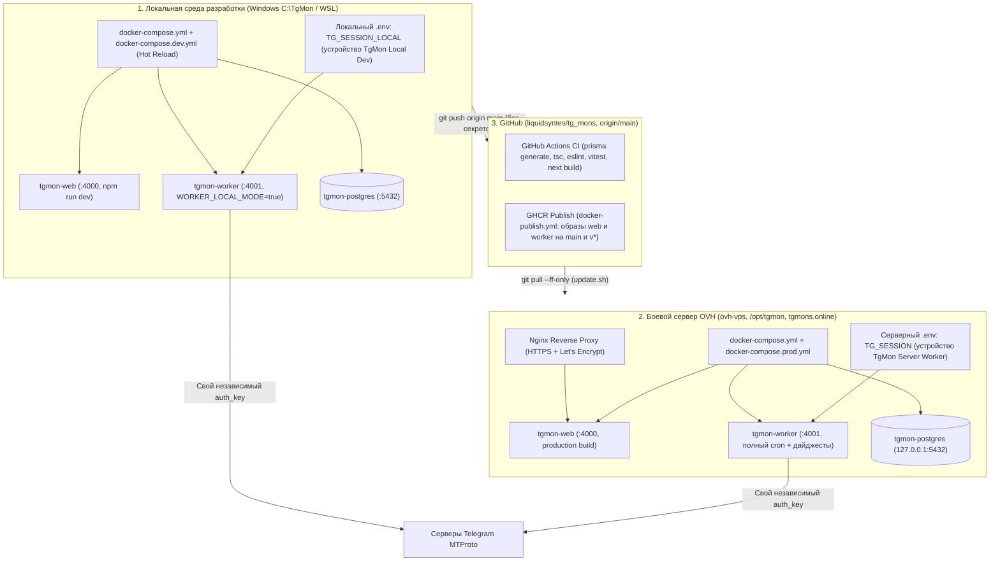
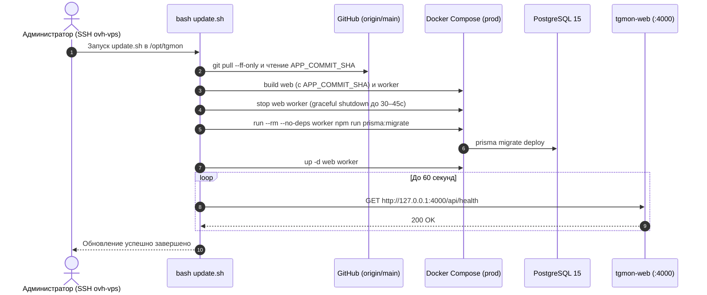
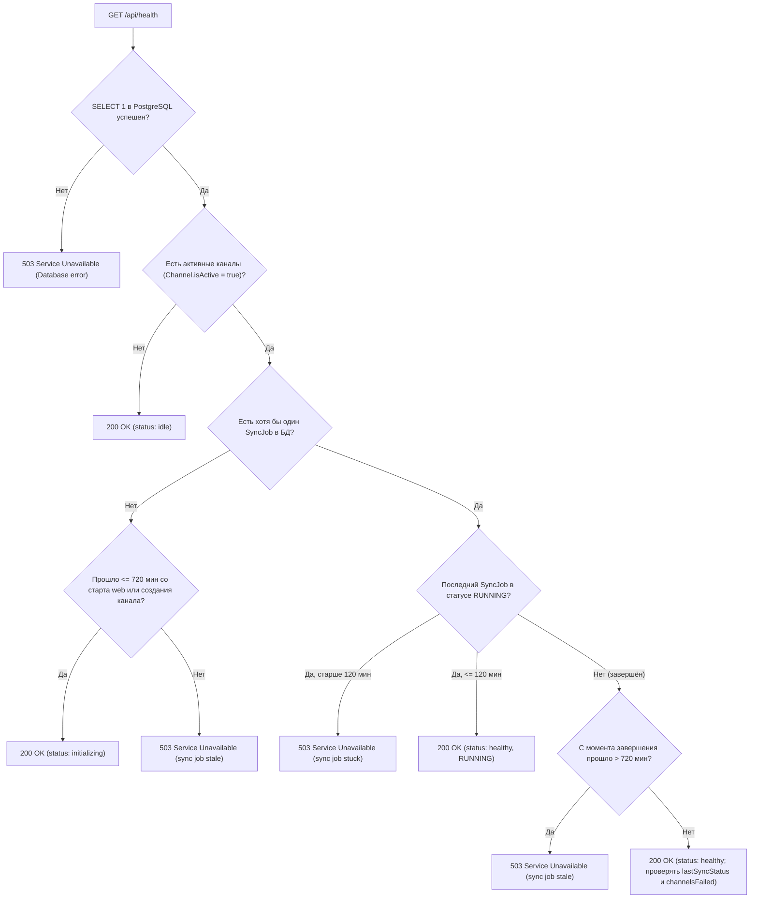

# Запуск и эксплуатация

Сверено **15 ноября 2026 года** (`v1.56`) с [package.json](../package.json), [dev-web.sh](../dev-web.sh), [update.sh](../update.sh), [Compose](../docker-compose.yml), [prod override](../docker-compose.prod.yml), [dev override](../docker-compose.dev.yml), [Dockerfile.web](../Dockerfile.web), [Dockerfile.worker](../Dockerfile.worker), [CI](../.github/workflows/ci.yml) и [GHCR Publish](../.github/workflows/docker-publish.yml).

## Среды проекта и изоляция Telegram-авторизации (`AuthKeyDuplicated`)



Проект эксплуатируется в **трёх чётко разделённых средах**, которые нельзя смешивать:

| Среда | Где находится | Как запускается | Какая MTProto-сессия используется | Как отображается в Telegram («Устройства») |
| --- | --- | --- | --- | --- |
| **1. Локальная разработка** | Windows (`C:\TgMon`) / WSL (`/mnt/c/TgMon`) | В Docker с Hot Reload: `docker compose -f docker-compose.yml -f docker-compose.dev.yml up -d` (или `bash dev-web.sh`) – контейнеры `tgmon-postgres` + `tgmon-web` + `tgmon-worker` | Только **`TG_SESSION_LOCAL`** (`WORKER_LOCAL_MODE=true`) | `TgMon Local Dev` |
| **2. Боевой сервер (Production)** | VPS OVH (`ovh-vps`, `/opt/tgmon`, домен `tgmons.online`) | Полный Docker-стек (`postgres` + `web` + `worker`) + Nginx + HTTPS, деплой через `bash update.sh` | Только **`TG_SESSION`** (`docker-compose.prod.yml`) | `TgMon Server Worker` |
| **3. GitHub** | `origin/main` (`liquidsyntes/tg_mons`, публичный репозиторий) | CI (`ci.yml`: `tsc`, `eslint`, `vitest`, `build`) и публикация образов в GHCR (`docker-publish.yml`) | Секреты и строки сессий в git **никогда не хранятся** | – |

### Почему разделены `TG_SESSION` и `TG_SESSION_LOCAL`

В протоколе Telegram MTProto один аккаунт (номер телефона и пара `TG_API_ID` / `TG_API_HASH`) может иметь сколько угодно параллельных активных сессий — так же, как одновременно работают Telegram на телефоне и ноутбуке. Однако если **одна и та же строка сессии (`auth_key`)** будет одновременно запущена с двух разных IP-адресов (например, на сервере OVH и на локальном ПК), Telegram немедленно выбросит ошибку **`AuthKeyDuplicated`** и принудительно сбросит авторизацию везде.

Поэтому действует жёсткое правило:
1. **Серверная сессия (`TG_SESSION`)** живёт **только на сервере OVH** (в `/opt/tgmon/.env`). Никогда не копируйте её на локальную машину.
2. **Локальная сессия (`TG_SESSION_LOCAL`)** создаётся отдельно один раз на локальной машине командой `npm run auth:local` или `npm run auth:local:qr` и хранится только в локальном `.env`.
3. В коде [src/worker/client.ts](../src/worker/client.ts) при запуске в локальном режиме (`npm run worker:local`, флаг `--local` или `WORKER_LOCAL_MODE=true`) воркер **игнорирует `TG_SESSION`** и требует именно `TG_SESSION_LOCAL`. Даже если в локальном `.env` случайно осталась строка `TG_SESSION`, локальный воркер к ней не прикоснётся.

---

## Требования и подготовка

- Node.js 22 и npm — версия Node совпадает с Docker и CI.
- PostgreSQL 15+ с расширением `pg_trgm`. SQLite не поддерживается.
- Для сбора — Telegram `TG_API_ID` / `TG_API_HASH` и MTProto-сессия (`TG_SESSION_LOCAL` локально, `TG_SESSION` на сервере).
- Все команды выполняются из корня проекта (`C:\TgMon` в Windows или `/mnt/c/TgMon` в WSL). Prisma Client генерируется под целевую ОС.

```bash
npm ci
cp .env.example .env
```

### Как пройти авторизацию MTProto локально (`TG_SESSION_LOCAL`)

Для локальной машины предусмотрены два способа выпустить изолированную сессию `TG_SESSION_LOCAL`:

1. **Через QR-код в браузере (рекомендуемый, без SMS и кодов подтверждения)**:
   ```bash
   npm run auth:local:qr
   ```
   - Скрипт поднимет временную локальную страницу **`http://localhost:4099`** с графическим QR-кодом (обновляется автоматически каждые 30 секунд).
   - Откройте `http://localhost:4099` в браузере на ПК.
   - На телефоне откройте **Telegram → Настройки → Устройства → Подключить устройство** и наведите камеру телефона на QR-код на мониторе.
   - **Важный нюанс**: не пытайтесь открывать сырую ссылку `tg://login?token=...` прямым кликом в браузере или терминале — Telegram специально блокирует прямые клики по `tg://login` защитной заглушкой *«Ваша версия Telegram устарела»*. Авторизация проходит именно при сканировании картинки QR-кода камерой из мобильного приложения.
   - Если на аккаунте включён облачный пароль 2FA, введите его прямо в появившееся поле на странице `http://localhost:4099` (или в терминале).
   - После успеха сессия автоматически запишется в `.env` в переменную `TG_SESSION_LOCAL`.

2. **Через телефон и код подтверждения в терминале**:
   ```bash
   npm run auth:local
   ```
   Запросит номер телефона, код из Telegram и пароль 2FA (если включён), после чего сохранит `TG_SESSION_LOCAL` в `.env`.

Для генерации серверной переменной `TG_SESSION` используются `npm run auth` либо неинтерактивные серверные скрипты в `scripts/auth/` (`qr-auth.ts`, `auth-file.ts`).

## Переменные окружения

| Переменная | Потребитель | Default / смысл |
| --- | --- | --- |
| DATABASE_URL | Prisma, web, worker | URL PostgreSQL; локально `127.0.0.1:5432/tgmon`, внутри Compose — `postgres:5432/tgmon` |
| POSTGRES_PASSWORD | docker-compose.prod.yml | Пароль БД для production-контейнера PostgreSQL (обязателен в `.env` на сервере) |
| TG_API_ID, TG_API_HASH | auth, MTProto | Ключи приложения Telegram (`my.telegram.org`) |
| TG_PHONE | auth | Телефон; при отсутствии CLI запросит его |
| TG_SESSION | серверный worker и `npm run auth` | Серверная MTProto-сессия (`TgMon Server Worker`); локально не используется |
| TG_SESSION_LOCAL | локальный worker (`worker:local`) и `auth:local` | Изолированная локальная MTProto-сессия (`TgMon Local Dev`), исключающая `AuthKeyDuplicated` |
| WORKER_LOCAL_MODE | worker | При `true` (или флаге `--local`) использует строго `TG_SESSION_LOCAL`; сам по себе cron не отключает |
| WORKER_DISABLE_CRON | worker | При `true` отключает расписания cron и `COLLECT_ON_STARTUP`, оставляя только внутренний API (`:4001`) для запросов из UI |
| COLLECT_API_TOKEN | вход Web UI (мастер-ключ), подпись cookie сессий, Bearer для worker | Непустой сильный случайный ключ; без него вход и защищённые маршруты недоступны |
| COLLECT_CRON | worker | `0 * * * *`; невалидное значение заменяется этим default с логом |
| COLLECT_ON_STARTUP | worker | Запуск только если значение строго `true`; при `WORKER_DISABLE_CRON=true` или `--no-cron` не выполняется |
| DEMOGRAPHICS_CRON | worker | `0 3 * * 0`; при невалидном значении weekly fallback |
| EVENTS_SCAN_CRON | worker | Необязательное UTC-расписание сканера событий, например `30 */6 * * *`; пустое значение отключает фоновый запуск. Локальный режим и WORKER_DISABLE_CRON также отключают его |
| WEB_INTERNAL_URL | worker | Адрес web для сброса кэша; в Compose `http://web:4000`, локально `http://localhost:4000` |
| WORKER_INTERNAL_URL | web | Адрес закрытого API worker; в Compose `http://worker:4001`, локально `http://localhost:4001` |
| WORKER_INTERNAL_HOST, WORKER_INTERNAL_PORT | worker | По умолчанию `127.0.0.1:4001`; Compose привязывает `0.0.0.0:4001` только внутри своей сети |
| TELEGRAM_REQUEST_TIMEOUT_MS | fetcher в worker и CLI-утилитах | 30000 мс |
| CHANNEL_MAX_CONSECUTIVE_ERRORS | retry-policy | 10; отключение при достижении порога |
| TELEGRAM_BOT_TOKEN, TELEGRAM_CHAT_ID | worker | Отправка пользовательских AlertRule, уведомлений об автоотключении и работа интерактивного бота команд |
| TELEGRAM_BOT_POLLING_ENABLED | worker | При значении `false` отключает фоновый `getUpdates` поллинг команд бота в worker (по умолчанию `true` при наличии `TELEGRAM_BOT_TOKEN`) |
| TELEGRAM_LOGIN_CLIENT_ID, TELEGRAM_LOGIN_CLIENT_SECRET | web | OIDC Client ID и Secret из BotFather > Login Widget; это отдельные значения, не токен бота |
| TELEGRAM_LOGIN_REDIRECT_URI | web | Точный HTTPS callback, зарегистрированный в BotFather, например `https://tgmons.online/api/auth/telegram/callback` |
| OPENROUTER_API_KEY | web AI/scanner | Общий резервный ключ для генеративных отчётов и сканера событий (включая Jev); также задаётся администратором через `/settings` |
| APP_TIMEZONE | web | IANA-часовой пояс тепловых карт, почасового распределения и рекомендации публикации; по умолчанию `Europe/Moscow` |
| APP_COMMIT_SHA | web | SHA исходного коммита для подписи версии в шапке. `update.sh` выставляет его после `git pull`; локальный dev читает `.git/HEAD` без этой переменной |
| HEALTH_STUCK_THRESHOLD_MINUTES | web health и захват SyncJob в worker | 120; Compose передаёт одинаковое значение обоим сервисам |
| HEALTH_STALE_THRESHOLD_MINUTES | web health и восстановление worker при холодном старте | 720; Compose передаёт обоим сервисам одинаковое значение |
| MY_CHANNEL_USERNAME | Никем не читается | Сохранён в примере, но не назначает «Мой канал» |

---

## Режим 1: Локальный Docker-стек (`dev-web.sh`)

Штатный локальный запуск использует `docker-compose.yml` вместе с `docker-compose.dev.yml`: PostgreSQL, web с Hot Reload и worker с `TG_SESSION_LOCAL`. Перед первым запуском соберите образы:

```bash
docker compose -f docker-compose.yml -f docker-compose.dev.yml up -d --build
```

При повторном запуске можно использовать `bash dev-web.sh`. Скрипт пытается остановить локальный PostgreSQL в WSL, если порт 5432 занят, предупреждает об отсутствии `TG_SESSION_LOCAL`, выполняет `docker compose ... up -d` **без `--build`** и запускает `npx prisma migrate deploy` на хосте. Для последней команды `DATABASE_URL` из локального `.env` должен указывать на доступный с хоста PostgreSQL. Скрипт не проверяет успешность сбора Telegram-данных.

Dev Compose запускает worker с `--local` и `WORKER_LOCAL_MODE=true`, поэтому он использует только `TG_SESSION_LOCAL`. При отсутствии сессии контейнер всё равно стартует, но MTProto-сбор не сможет авторизоваться. `WORKER_DISABLE_CRON` в dev Compose по умолчанию `false`: расписания основного сбора, демографии и рекламного охвата остаются включёнными; дайджест и автоматическое сканирование событий в локальном режиме не планируются. Для режима только по запросу задайте `WORKER_DISABLE_CRON=true`.

Если PostgreSQL уже запущен и нужен ручной запуск Node.js без Docker, доступна команда `npm run dev:local`: она запускает web и `worker:local` с `--local --no-cron`. Этот вариант требует корректного `DATABASE_URL`, локальной сессии для MTProto-операций и свободных портов 4000/4001.

---

## Режим 2: Production-развёртывание на сервере OVH (`update.sh` и полный Docker Compose)

На боевом сервере (`ovh-vps`, каталог `/opt/tgmon`, домен `tgmons.online`) работает полный стек в Docker (`postgres` + `web` + `worker`) с обратным прокси Nginx и сертификатами Let's Encrypt (`issue-cert.sh`).

### Штатное обновление сервера

На сервере в `/opt/tgmon` обновление выполняется скриптом [update.sh](../update.sh):
```bash
bash update.sh
```

Скрипт передаёт текущий SHA в сборку web-образа. В шапке показываются его первые семь символов (`v. abc1234`). При ручной сборке образа без `update.sh` передайте `APP_COMMIT_SHA` из того же checkout; иначе шапка покажет `v. н/д`. В локальном dev-контейнере версия читается из смонтированной `.git` и обновляется после нового коммита при перезагрузке страницы.

Скрипт последовательно выполняет:
1. `git pull --ff-only` из `origin/main`.
2. `docker compose -f docker-compose.yml -f docker-compose.prod.yml build web worker`.
3. Остановка `web` и `worker`.
4. Применение миграций БД: `docker compose -f docker-compose.yml -f docker-compose.prod.yml run --rm --no-deps worker npm run prisma:migrate`.
5. Запуск обновлённых `web` и `worker`, затем ожидание ответа `/api/health` до 60 секунд.



В `.env` на сервере обязательно должны быть заданы `POSTGRES_PASSWORD`, `COLLECT_API_TOKEN`, `TG_API_ID`, `TG_API_HASH`, серверная `TG_SESSION` и `WEB_INTERNAL_URL=http://web:4000`.

---

## Режим 3: Ручная пересборка локальных образов

После изменений файлов, которые включаются в образы, пересоберите затронутые сервисы через Compose. Для полного первого запуска:

```bash
docker compose -f docker-compose.yml -f docker-compose.dev.yml up -d --build
```

Dev override монтирует исходный код в web и worker, запускает `npm run dev` и `npx tsx watch src/worker/index.ts --local`. Не запускайте одновременно web на хосте и в контейнере: оба используют порт 4000.

## Порт 4000 и диагностика

TgMon работает на `http://localhost:4000/`. На этом порту не должен висеть другой процесс.

```bash
curl -i http://localhost:4000/
curl -i http://localhost:4000/api/health
```

Если порт занят или браузер открывает старый процесс: в WSL проверьте `ss -ltnp 'sport = :4000'`, в PowerShell — `Get-NetTCPConnection -State Listen -LocalPort 4000`.

## Миграции и демонстрационные данные

- `npm run prisma:migrate` выполняет **prisma migrate deploy**: применяет существующие миграции из `prisma/migrations/`, не создаёт новые.
- `npm run prisma:generate` обновляет Prisma Client, не меняя БД. `npm run build` также запускает генерацию перед Next build.
- `npm run prisma:push` синхронизирует схему без истории миграций; не используйте его как обычную процедуру обновления существующей БД.
- `npm run seed` удаляет посты, снимки и каналы, затем создаёт демонстрационные данные. Только для отдельной тестовой базы!
- Для Windows `EPERM` при `prisma generate` проверьте запущенные Node-процессы этого проекта, которые могут удерживать Prisma Query Engine, и остановите их перед генерацией.

Последние миграции включают (всего 33 миграции в `prisma/migrations/`):
- `20261114063600_add_content_plan_to_saved_posts` – поля контент-плана (`status`, `planned_for`, `draft_text`) в таблице `user_saved_posts`;
- `20261114042500_add_post_deletion_tracking` – поля отслеживания удалений рекламных постов (`deleted_at`, `deleted_after_hours`, `last_checked_at`) в `posts`;
- `20261113053607_add_ad_placements` – таблица рекламных сделок `ad_placements`;
- `20261028192148_add_telegram_registration` – статусы и профиль Telegram OIDC в `users`;
- `20261028155134_add_post_engagement_hour` – почасовые приросты реакций и пересылок `post_engagement_hours`.

## Telegram Login, заявки и доступ к Web UI

Новые пользователи входят через Telegram OpenID Connect. Первый успешный вход создаёт в `users` заявку `PENDING`; только администратор переводит её в `ACTIVE`. `BLOCKED` сохраняет Telegram `sub` и закрывает как новый вход, так и действующую cookie. Удаление заявки `PENDING` позволяет человеку подать её снова. Старые пользователи с паролем остаются `ACTIVE` после миграции и могут привязать Telegram в `/settings`. Парольная регистрация по инвайту выключена; таблица старых `InviteCode` остаётся в БД без удаления данных.

### Настройка BotFather

1. В [@BotFather](https://t.me/BotFather) откройте `/mybots`, выберите `@tgmons_bot` и перейдите в **Login Widget**, режим OpenID Connect.
2. В **Redirect URIs** добавьте точный адрес `https://tgmons.online/api/auth/telegram/callback`; в **Trusted Origins** добавьте `https://tgmons.online`. При другом домене замените оба адреса согласованно.
3. Сохраните Client ID и Client Secret в серверном окружении web как `TELEGRAM_LOGIN_CLIENT_ID` и `TELEGRAM_LOGIN_CLIENT_SECRET`; `TELEGRAM_LOGIN_REDIRECT_URI` должен точно совпадать с зарегистрированным callback. Client Secret не помещайте в Git, сообщения и логи. Токен `TELEGRAM_BOT_TOKEN` для уведомлений не заменяет OIDC Secret.
4. Для живой проверки до production зарегистрируйте отдельный HTTPS origin и callback тестовой среды. Локальный `http://localhost:4000` с production callback не начинает OIDC-вход: приложение явно отклоняет несовпадающий origin. Unit-тесты выполняются без внешнего Telegram.

### Поведение и границы доступа

- `src/middleware.ts` работает в Node.js runtime и проверяет текущие роль и `User.accessStatus` в PostgreSQL на каждом защищённом запросе. `PENDING` видит только `/pending`, `/api/auth/me` и выход; `BLOCKED` не получает доступ даже с ранее выданной cookie. Межсервисный Bearer остаётся отдельным путём.
- Telegram OIDC использует Authorization Code, PKCE, `state`, `nonce`, проверку подписи и полей ID-токена. Временная flow-cookie имеет `SameSite=Lax`, чтобы вернуться с сайта Telegram; обычная сессия остаётся `HttpOnly`, `SameSite=Strict` и живёт 12 часов. Телефон и разрешение отправлять сообщения пользователю не запрашиваются.
- Обратные переходы после Telegram-входа строятся от публичного `TELEGRAM_LOGIN_REDIRECT_URI`, чтобы не раскрывать внутренний адрес web-контейнера. При обмене кода на токен `client_id` передаётся в теле запроса, а Basic Authorization содержит исходные Client ID и Secret без дополнительного форм-кодирования, согласно [документации Telegram](https://core.telegram.org/bots/telegram-login).
- Только администратор управляет заявками в `/settings` через `/api/admin/registrations`. Telegram-вход не выдаёт роль `ADMIN`. Резервный мастер-ключ и парольный вход существующих аккаунтов сохраняются. `POST /api/auth/register` разрешает только первичное создание администратора при пустой базе администраторов и верном мастер-ключе.
- Общие `Channel`, `Post` и метрики не копируются при регистрации. Новый пользователь после одобрения получает пустой личный список `UserChannel` и может импортировать подписанный список каналов администратора.
- Nginx должен передавать внешний `Host` и `X-Forwarded-Proto=https`, чтобы cookie получала `Secure`, а проверка `Origin` сопоставляла адрес сайта. Перед запуском версии с новой схемой примените `prisma migrate deploy`.

## Интерактивные команды Telegram-бота

При наличии `TELEGRAM_BOT_TOKEN` и `TELEGRAM_BOT_POLLING_ENABLED !== "false"` worker в фоновом режиме (`src/worker/bot-poller.ts`) запускает неблокирующий long-polling (`getUpdates`) для обработки интерактивных команд без открытия входящих портов для webhook.

- **Авторизация по Chat ID**: доступ предоставляется активным пользователям (`User.accessStatus = ACTIVE`), у которых в `/settings` указан соответствующий `Telegram Chat ID`, либо чату из переменной `TELEGRAM_CHAT_ID`. Неизвестным чатам бот возвращает только их числовой `Chat ID` и инструкцию по привязке без раскрытия данных системы.
- **Поддерживаемые команды** (`src/lib/telegram-bot-commands.ts`):
  - `/start`, `/help` – справка по командам и статус привязки чата;
  - `/status` – статус последнего цикла сбора `SyncJob`, число активных каналов и сводка по «Моему каналу»;
  - `/digest` – внеочередной дайджест за последние 24 часа, включая лучший пост по ERR и счётчик антифрод-сигналов;
  - `/channel @username` (а также пересланный пост из публичного канала или сообщение со ссылкой `t.me/...`) – экспресс-карточка метрик (подписчики, динамика 7д/30д, ER, ERR, доля рекламы, Trust Score) со ссылкой в веб-интерфейс;
  - `/add @username` – постановка нового канала на мониторинг через очередь `TaskCoordinator` worker и привязка к `UserChannel`;
  - `/events` (алиас `/afisha`) с необязательными фильтрами (`today`/`сегодня`, `weekend`/`выходные`, `week`/`неделя`, `month`/`месяц`, `free`/`бесплатно` и текстовый запрос) – список ближайших мероприятий афиши с дедупликацией и отсеиванием анонсов-дайджестов;
  - `/event <id>` – подробная карточка мероприятия, ссылки на источники и кнопка добавления в Google Calendar;
  - `/dismiss <id>` (алиас `/hide <id>`) – скрытие мероприятия из афиши (`UserDismissedEvent` для привязанного пользователя или глобально в системном админ-режиме).
- **Изоляция и безопасность**: `TELEGRAM_BOT_TOKEN` никогда не записывается в логи (`bot[REDACTED]`), конфликт `409 Conflict` и сетевые сбои обрабатываются с паузой и не останавливают основной цикл сбора MTProto. Чтобы временно отключить поллинг команд (например, при запуске дублирующего инстанса), задайте `TELEGRAM_BOT_POLLING_ENABLED=false`.

## Проверка после запуска

```bash
docker compose ps
curl -i http://localhost:4000/api/health
```



Логи нужного сервиса можно изучить локально через `docker compose logs --tail=100 worker` или `web`; они могут содержать данные каналов, поэтому перед публикацией их нужно обезличить.

Health проверяет соединение с БД через `SELECT 1`. Без активных каналов он возвращает 200 `idle`. Если активные каналы есть, но SyncJob ещё нет, в пределах 720 минут с запуска web или создания самого раннего активного канала возвращается 200 `initializing`; после этого 503 `sync job stale`. Перезапуск web начинает это окно ожидания заново. Зависший незавершённый цикл старше 120 минут и завершённый старше 720 минут при активных каналах дают 503. Недоступная БД также даёт 503. **Свежий FAILED/PARTIAL может вернуть 200**: проверяйте lastSyncStatus и channelsFailed в теле. UI отдельно считает канал stale после 3 часов.

При `COLLECT_ON_STARTUP=false` worker проверяет последний SyncJob. Если активные каналы есть, а задание устарело по настроенному порогу health (по умолчанию 720 минут после завершения или 120 минут для незавершённого задания), он запускает один восстановительный сбор. При свежем задании worker ждёт следующего cron или ручного запроса кнопкой в UI / `POST /api/collect/run`; второй одновременный запуск получит 409. Проверяйте `result.successCount/errorCount`, затем `lastSyncStatus=COMPLETED` и `channelsFailed=0`. Сам ответ `success:true` не гарантирует успех всех каналов.

Если работающий worker пропустил один или несколько запусков основного cron, например после паузы хоста, событие `execution:missed` запускает один восстановительный сбор через общую очередь задач. Пока процесс не возобновился, health может показывать `sync job stale`. При полном перезапуске старое задание проверяется отдельно, поэтому пропущенные до запуска интервалы не вызывают серию отдельных сборов.

При остановке worker новые задачи отклоняются, активному заданию даётся до 30 секунд; основной сбор останавливается между каналами. Если он не завершился, текущий SyncJob переводится в PARTIAL или FAILED и TelegramClient отключается. Compose задаёт `stop_grace_period: 45s`, чтобы Docker не прервал эту процедуру раньше времени.

Проверьте доступность главной, добавленного канала и последних метрик. Отсутствие демографии не обязательно ошибка запуска: задание недельное и требует canViewStats. Рекламные точки появляются отдельным cron в :15, если найдены подходящие isAd-посты. Ни демография, ни рекламный сбор не выполняются startup-триггером основного цикла.

## Восстановление ранее пустых статей

После обновления обоих образов утилита читает старые пустые посты по ID, даже если они уже вне последних 200 сообщений. N — внутренний ID канала TgMon. Сначала выполните проверку:

```bash
docker compose exec worker npx tsx scripts/backfill-articles.ts --channel-id=N
```

Проверьте `recoverable` и `unavailable`, затем выполните сохранение:

```bash
docker compose exec worker npx tsx scripts/backfill-articles.ts --channel-id=N --apply
```

Обновляются только пустые тексты статей, их рекламная классификация и упоминания. Миграций, пересоздания постов и изменения счётчиков нет. Для больших выборок используйте `--limit` и `--after-id` по [инструкции](../scripts/README.md#восстановление-текста-статей). Не все пустые сообщения являются статьями; обычные медиа без подписи не получат вымышленный текст.

Утилита не сбрасывает web-кэш. После записи дождитесь его истечения (метрики — 5 минут), вызовите штатный `POST /api/internal/invalidate-cache` с Bearer-токеном из защищённого окружения либо проверьте после следующего успешного основного сбора. Не вставляйте реальный токен в документацию или общий терминальный лог. Поиск `/api/posts/search` не кэшируется этим кэшем.

Повторный dry-run не должен вновь предлагать уже восстановленные статьи. Откройте публикацию в TgMon, проверьте полный текст и прокрутку на десктопной и мобильной ширине. Сохранённые AI-отчёты не переписываются; нужные отчёты создайте заново через UI.

## AI и настройки

Для генерации задайте ключ на `/settings` или OPENROUTER_API_KEY web-процессу. `callOpenRouter` использует сохранённую модель либо `z-ai/glm-5.3-flash`, JSON response format и timeout 60 секунд; scanner использует 120 секунд. Перед извлечением событий Jev вызывается через OpenRouter Decisions API с тем же ключом и моделью `~typesafe/jev-latest`: до 2000 постов за запуск, до 10 постов за запрос, не более четырёх одновременных запросов, таймаут каждого 15 секунд, повтор при 429/529. При недоступности Jev сканер использует прежний отбор по ключевым словам и сообщает об этом в интерфейсе. Посты отправляются внешнему провайдеру при ручном сканировании. Фактическая доступность моделей зависит от провайдера. Сохранённые ключ и модель применяются к запросам OpenRouter. Jev использует сохранённый или резервный ключ и модель `~typesafe/jev-latest`. Кэш настроек живёт до 30 секунд в каждом web-процессе; сохранение сбрасывает кэш текущего процесса.

При заданном `EVENTS_SCAN_CRON` серверный worker проверяет через защищённый web API наличие ключа OpenRouter и запускает тот же сканер по расписанию. Это отдельная задача, её ошибка логируется и не останавливает сбор Telegram. В локальном режиме фоновый сканер выключен. Изменения схемы `eventsScannedAt` требуют применения миграции и генерации Prisma Client в web и worker; сам сканер не запускайте ради smoke-проверки, так как он обращается к внешним моделям и меняет `Event` в БД.

### Обновление «Афиши»

При изменении только страницы «Афиши» или отбора через Jev достаточно пересобрать web и пересоздать только его контейнер:

```bash
docker compose build web
docker compose up -d --no-deps --force-recreate web
docker compose ps
curl -i http://localhost:4000/
curl -i http://localhost:4000/api/health
```

В Windows PowerShell вместо `curl -i` используйте `curl.exe -i`. Если команда `docker` недоступна в WSL, выполните шаги Compose из PowerShell в `C:\TgMon`.

Загрузка изображений постов выполняется сборщиком worker. При изменении этого кода обновите образ worker. Для новой установки до запуска сервисов примените миграцию `20261016000000_add_post_images`; ранее собранные сообщения получат изображение только при повторном проходе сборщика по ним. `GET /api/posts/:id/image` читает сохранённые байты из БД.

Затем откройте `/events` и проверьте загрузку страницы. Кнопка «Сканировать события» запускает `POST /api/events/scan`, вызывает внешние модели и может создать `Event` и `EventMention` в БД; не используйте её как проверку доступности web. Ответ сканера содержит `selectionMode`: `jev` при отборе моделью, `keyword_fallback` при возврате к фильтру по словам и `no_candidates`, когда нет непустых постов. Интерфейс отдельно сообщает о fallback.

Порог основного признака 0.2 и веса дополнительных признаков пока не откалиброваны на размеченных постах TgMon. Jev передаёт в LLM неоднозначные посты и исключает только явные неанонсы. Оценки отдельных постов не сохраняются в БД; для предметной настройки потребуется отдельная выборка с проверенными вручную примерами.

## Зависимости и CI

Используйте `npm ci` с зафиксированным lockfile. package.json содержит overrides: next → postcss 8.5.26 и sharp 0.35.4; @prisma/config → deepmerge-ts 8.0.2. Пересматривайте их при обновлении родительских пакетов; наличие override само по себе не подтверждает отсутствие уязвимостей.

CI использует Node 22: Prisma generate, `npx tsc --noEmit`, `npx eslint src`, `npm test`, затем `npm run build`. Скрипт `npm run lint` вызывает работающий в Next.js 15, но устаревающий `next lint`; CI использует прямой вызов ESLint. При ограничениях запуска тестовых процессов можно проверить `npm test -- --maxWorkers=2`; это не меняет набор тестов. Workflow `ci.yml` срабатывает на push `main`/`VPS_Ready`, PR в `main` и вручную; отдельный workflow `.github/workflows/docker-publish.yml` на push `main`, тегах `v*` и ручном запуске собирает и публикует Docker-образы `ghcr.io/liquidsyntes/tg_mons-web` и `ghcr.io/liquidsyntes/tg_mons-worker` в GHCR (без автоматического деплоя на OVH). Совместимость cron и Prisma config проверяется отдельными unit-тестами; результаты нужно получать текущим запуском, а не брать из старых отчётов.

### Модель предварительного отбора событий

`EVENT_DECISION_MODEL` для web принимает `~typesafe/jev-latest` (по умолчанию) или `google/gemini-decision-1`. Compose передаёт параметр web; при смене значения нужно пересоздать web. Используется существующий общий ключ OpenRouter. Модель генеративного извлечения задаётся прежними настройками AI и от этого параметра не зависит. Оба классификатора используют Decisions API. При ошибке сохраняется keyword fallback; production-повторы 429/529 прежние. Каскад двух моделей не включён. Результаты первоначального сравнения и offline-инструмент: [оценка афиши](../src/lib/events/eval-data/README.md).

### Применение учёта AI

Перед запуском кода #87 применить `npm run prisma:migrate` и сгенерировать Prisma-клиенты web/worker. В dev Compose код подключён bind mount, но Prisma-клиенты находятся в отдельных volumes node_modules: выполнить generate в обоих сервисах. Перезапуск БД не требуется. Новые лимиты доступны ADMIN в настройках использования AI, production-переменные окружения не добавлены.

Интеграционные тесты admission запускаются только с `AI_OPERATIONS_INTEGRATION=1` и отдельной БД, имя которой заканчивается `_ai87_test`. Сначала применить миграции к этой тестовой БД, затем `npm test -- --maxWorkers=2 src/lib/ai-operations/__tests__/store.integration.test.ts`. Тесты очищают только журнал и настройки тестовой БД, обращение к рабочей БД запрещено проверкой имени. Они проверяют конкурентные транзакции и два отдельных Node-процесса, провайдер замокан. В обычном CI эти тесты пропускаются; unit/API-тесты выполняются без сети.
